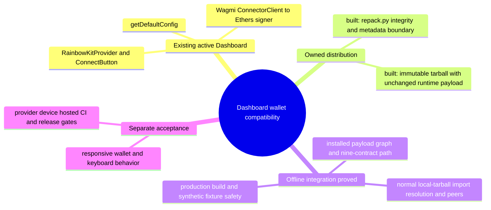

# Dashboard owned RainbowKit compatibility boundary

## 1. Purpose

The Dashboard uses RainbowKit wallet connection UI and configuration, Wagmi
state, and an Ethers signer for its existing contract panels (src/main.jsx,
src/App.jsx, src/config/wagmi.js, src/hooks/useEthersSigner.js). This
candidate preserves those interfaces and shipped implementation bytes. It
changes the owning package identity and its normal CSS dependency to avoid the
current deepmerge owner edge. It is project-owned compatibility work, not an
upstream-supported RainbowKit release or an accepted remediation.

## 2. Trace

1. Preserved RainbowKit 2.2.11 payload -> existing App/Provider/config and
   wallet/contract interfaces: source-built and covered by offline checks.
2. Upstream archive -> deterministic repack.py -> immutable
   IFR-owned distribution -> exact CSS 1.21.3 -> deepmerge-ts: adopted by Root
   and shown to Gio before the first diff; artifact qualification passed.
3. Dashboard normal local-tarball dependency and existing import identities ->
   owned distribution: normal npm key/name semantics proved in an isolated
   fixture and the actual installed graph. Local payload, peer, contract,
   dependency and build checks pass; visual and provider acceptance are separate.

## 3. Modules

| Module | Task | Entry | State |
| --- | --- | --- | --- |
| Dashboard | Wallet UI | src/main.jsx | Built |
| Owned package | Data repack | repack.py | Qualified |
| Integration | npm graph | package.json | Offline PASS |

## 4. Wiring

The owner distribution keeps RainbowKit exports, peers, runtime JS/CSS/types
and license. Only package name/version and CSS dependency differ. No wrapper,
new connector, override or resolver hook is introduced.

## 5. Gaps

Artifact qualification alone does not prove integration or alert closure.
The actual install now verifies normal import resolution, all 971 package
files and modes, singleton peers, no deepmerge at any installed or locked
copy, decoder 0.5.1, Vite 6.4.5 and the nine-contract signer/read-only path.
Local build and fixture safety checks pass. Full and production audits retain
the existing Zod advisory; this is not a clean Dashboard claim. Responsive
visual acceptance, independent review, hosted CI and release acceptance remain
separate gates. The common maps and final integration remain Root-owned.

## 6. Diagrams

Scoped map.puml and main-path.puml describe packaging, normal dependency
integration and the separate preview gate. No rendering claim is made unless
a renderer is actually used.

## 7. Next unit

Root admitted the deterministic artifact checkpoint and the bounded Dashboard
manifest/lock integration. Preserve every active
wallet/mobile/Wagmi/ConnectorClient/nine-contract interface. Application
imports and runtime source stay unchanged. Shared maps and root package files
remain outside this worker's scope. Heavy installation follows Root's shared
resource barrier; a timed-out partial installation is not acceptance evidence.

## Phase2 admitted graph and render contract

Root admitted the ordinary local-file-key proof and coordinated Dashboard
install after the artifact checkpoint. The zero-dependency fixture proved
npm10.9.7 retains the explicit owned internal package name while all four
existing RainbowKit import/export paths resolve normally. No custom resolver
or source import change is needed. The actual installed package/export paths
and peer instance identities also pass their owning qualification checks.

New alerts493/494 add two mapped edges: Dashboard dev Vite6.4.4 -> normal
same-major6.4.5, and retained query-string9.5.1 -> normal declared
decode-uri-component^0.5.0 -> patched0.5.1. Existing four overrides stay
byte-identical; the prior SDK exact query-string7.1.3 mismatch is a retained
limitation, not a newly supported SDK graph. No SDK/parent major is
introduced. The starting nine-context repository alert inventory is retained
in the evidence; this unit does not change the other contexts' decisions.

Render hop remains RainbowKit CSS dependency -> shipped
RainbowKitProvider/darkTheme/ConnectButton -> unchanged Dashboard app.
Required local FVA viewports are1440x1000,1180x820,820x1180,390x844. Preserve
disconnected/connected/loading/error/unsupported-chain states, account/chain
modal and keyboard focus, wallet choice/QR entry/cancel/reconnect, current
typography/layout, no clipping/overlap/overflow and measured touch targets.
Any pre-existing issue must be recorded separately rather than silently
changed or passed. Only synthetic wallets/RPC may be used; no real
pairing/signature/transaction. Root's existing peer owns browser inspection
once a bounded preview and fixture are ready.

## Test-only preview hop

The unchanged Dashboard build is served on loopback by
scripts/serve-compat-preview.mjs. It injects
scripts/compat-wallet-fixture.js before the application module without
editing dist or introducing a product flag. Its EIP-1193/EIP-6963 provider has
synthetic accounts, filters foreign provider announcements, rejects signing
and broadcasts, and redirects read RPC to scripts/compat-rpc-fixture.mjs.
The server decodes the actual ABI arrays, permits read-only selectors and
encodes nine-decimal synthetic data. CSP and transport guards prevent remote
SDK/RPC traffic. This fixture is not a wallet, device, provider or chain
acceptance test.

The existing ConnectorClient-to-Ethers and nine-contract contracts are
exercised by scripts/test-wallet-contracts.mjs. Distribution bytes, ordinary
import/export placement, peer identity and all installed package copies are
checked by scripts/test-owned-rainbowkit.mjs. Preview safety negative controls
are in scripts/test-compat-preview.mjs. No real signing or payable operation
is needed for these checks.
