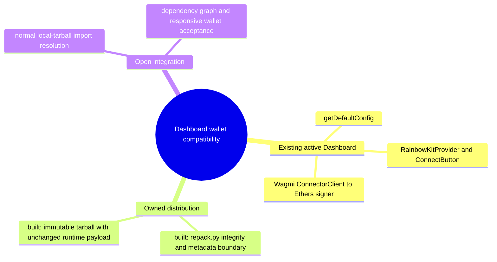

# Dashboard owned RainbowKit compatibility boundary

## 1. Purpose

The Dashboard uses RainbowKit wallet connection UI and configuration, Wagmi state, and an Ethers signer for its existing contract panels (src/main.jsx, src/App.jsx, src/config/wagmi.js, src/hooks/useEthersSigner.js). This candidate preserves those interfaces and shipped implementation bytes. It changes the owning package identity and its normal CSS dependency to avoid the current deepmerge owner edge. It is project-owned compatibility work, not an upstream-supported RainbowKit release or an accepted remediation.

## 2. Trace

1. App/Provider/config imports -> Dashboard manifest/lock -> published RainbowKit2.2.11: currently built.
2. Proposed replacement owner -> deterministic repack.py -> immutable IFR-owned distribution -> exact CSS1.21.3 -> deepmerge-ts: adopted by Root and shown to Gio before the first diff; artifact qualification in progress.
3. Dashboard normal local-tarball dependency and existing import identities -> owned distribution: open; package-manager semantics and application compatibility are not yet proved.

## 3. Modules

| Module | Task | Entrypoint | State |
|---|---|---|---|
| Dashboard | Existing wallet/state/contracts UI | src/main.jsx / App.jsx | built, unchanged |
| Owned distribution packaging | Bind upstream integrity, preserve payload, alter only allowed metadata | vendor/rainbowkit-compat/repack.py | candidate |
| Local dependency integration | Reproduce a normal lock and preserve imports | Dashboard package.json/lock | open |

## 4. Wiring

The owner distribution keeps RainbowKit exports, peers, runtime JS/CSS/types and license. Only package name/version and CSS dependency differ. No wrapper, new connector, override or resolver hook is introduced.

## 5. Gaps

Artifact qualification does not prove npm local-file name/import resolution, a patched dependency graph, UI behavior or alert closure. Other Zod contexts remain open. Root controls the coordinated install GO and final integration. The common architecture maps remain Root-owned.

## 6. Diagrams

Scoped map.puml and main-path.puml describe packaging and the open integration hop. No rendering claim is made unless a renderer is actually used.

## 7. Next unit

Finish deterministic artifact/source qualification first. Preserve every active wallet/mobile/Wagmi/ConnectorClient/nine-contract interface. Do not change application imports, package/lock, shared maps, root package files or run an install/build before Root GO.

