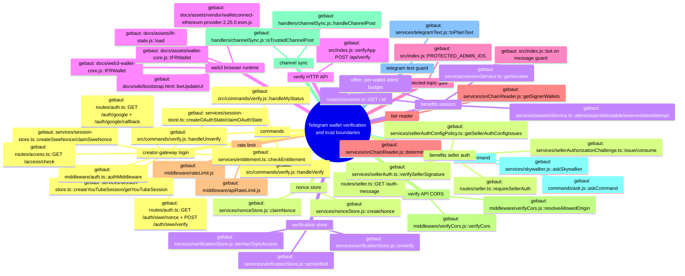
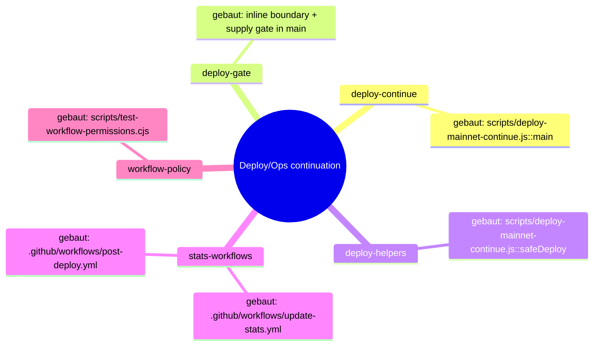
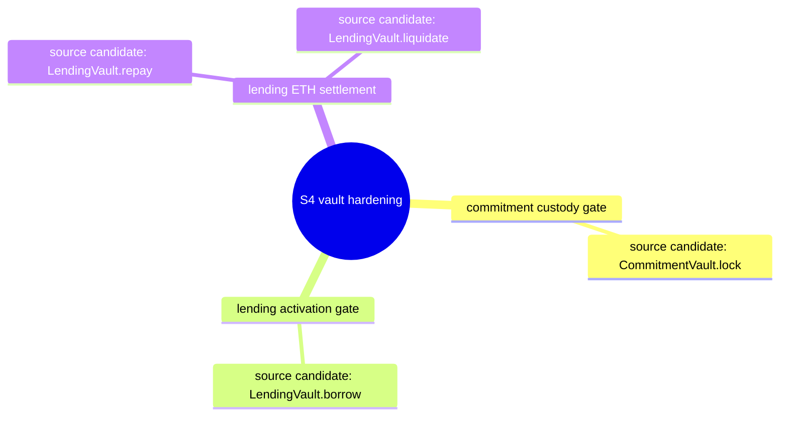
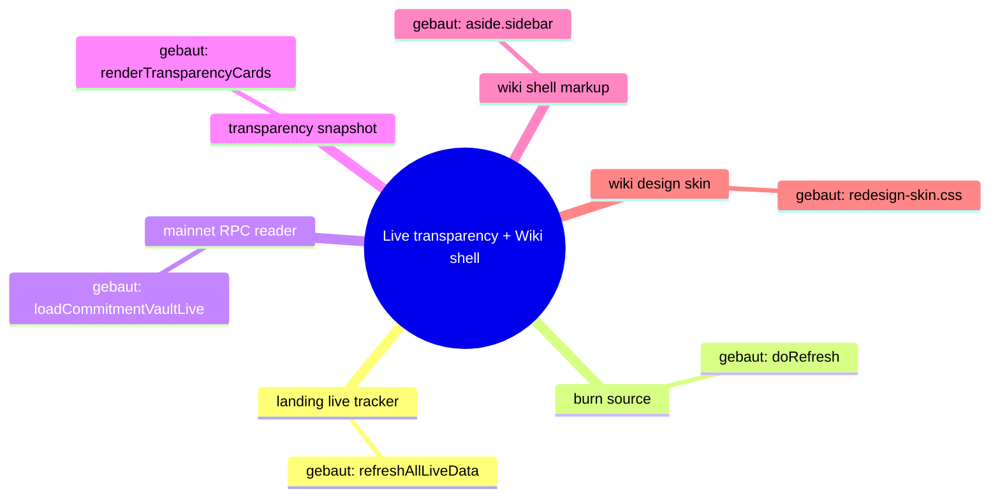
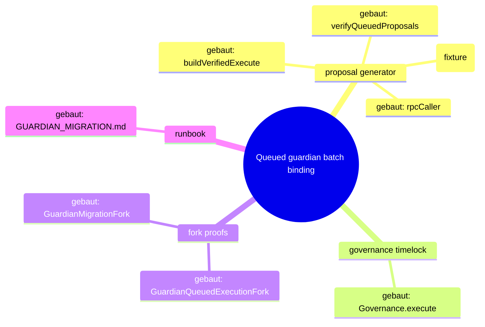
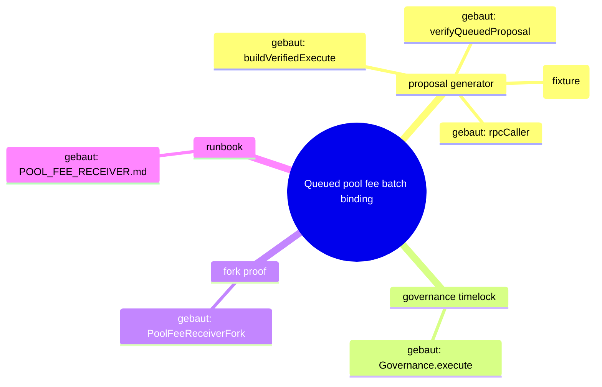
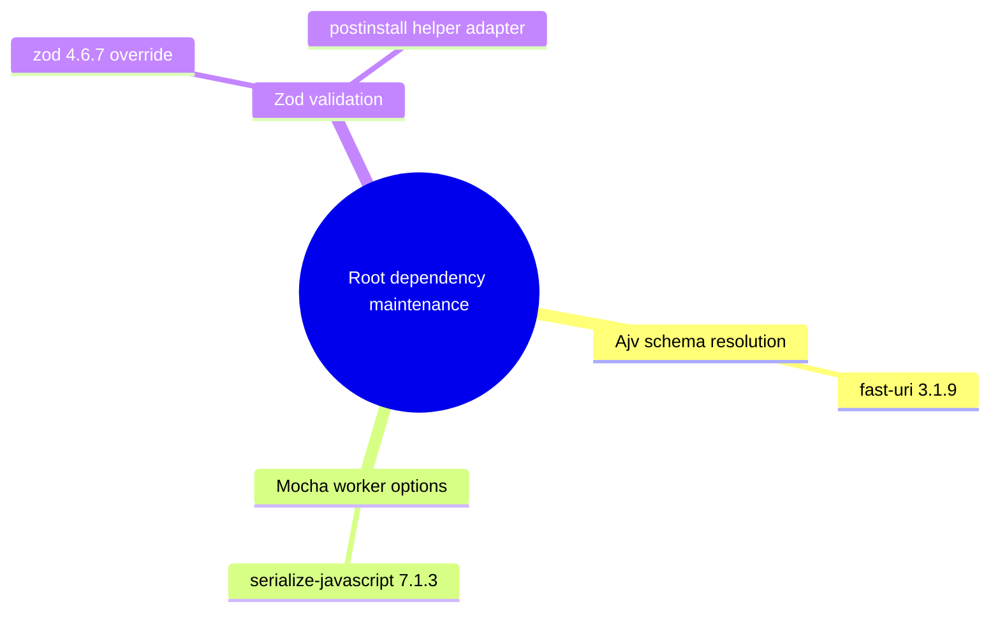
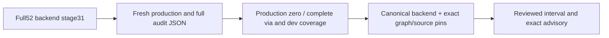
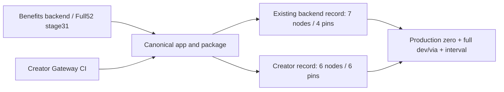
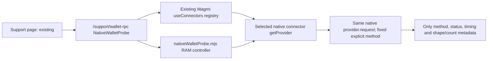

# Architecture Map — Security Traces

Scope: the verification/authorization trace and the privilege/CORS/content-trust
traces inside `apps/telegram/telegram-bot` (tasks
INFERNO-SECURITY-S2A-TELEGRAM-STATUS-20260926,
INFERNO-SECURITY-S2B-TELEGRAM-IDENTITY-20260926 and
INFERNO-SECURITY-S2C-TELEGRAM-TRUST-20260926, integrated on one base), and the
Creator Gateway login trace inside `apps/creator-gateway` (task
INFERNO-SECURITY-S2D-CREATOR-AUTH-20260926), and the Benefits seller
authorization/session trace inside `apps/benefits-network/backend` (task
INFERNO-SECURITY-S2E-BENEFITS-SELLER-AUTH-20260927), and the shared Web3
browser runtime trace `docs/web3/index.html` → `docs/web3-wallet-core.js` /
`docs/assets/wallet-core.js` → `docs/assets/ifr-state.js` → Web3 status
renderers (task INFERNO-SECURITY-S2F-WEB3-RUNTIME-20260927).
It also maps the Points voucher issue/validation trace inside `apps/points-backend`
(task INFERNO-SECURITY-S2G-POINTS-CWA14-20260927).
It also maps the protocol data API trace inside `apps/data-api` (section 8) and the Deploy/Ops
mainnet continuation trace (task T-137 S3 hardening, section 9).
The rest of the repository is intentionally unmapped.

## 1. Grundidee

The IFR Telegram bot gates protected forum topics (Core Dev, Council, Vote, Dev & Builder)
by binding a Telegram account to an Ethereum wallet: the bot issues a single-use nonce in
private chat, the user signs it on `ifrunit.tech/wiki/verify.html`, and the bot's Express
API checks the signature and stores the binding (`apps/telegram/telegram-bot/README.md`,
`apps/telegram/telegram-bot/src/index.js`). A per-message guard in protected threads then
allows or deletes messages based on the wallet's on-chain tier
(`apps/telegram/telegram-bot/src/services/verificationStore.js`,
`apps/telegram/telegram-bot/src/services/onChainReader.js`).

The same bot publishes generated or external content into the community (`/ask` AI
answers, channel → community sync with auto-pin). Both directions — privilege granting
and content publishing — fail closed: no hardcoded fallback identities, no substring
origin checks, no untrusted markup, no pins of untrusted channel content
(`src/index.js`, `src/services/onChainReader.js`).

## 2. Spur (Hop-Liste)

Verification/authorization trace:

1. `src/index.js::bot.command('verify')` → `src/commands/verify.js::handleVerify` — Daten: Telegraf `ctx` (userId, chat type)
2. `commands/verify.js::handleVerify` → `services/nonceStore.js::createNonce` — Daten: userId → nonce string
3. Browser (verify.html) → Traefik (TLS, ein Proxy-Hop, trusted via `VERIFY_TRUST_PROXY`) → `src/index.js::verifyApp POST /api/verify` — Daten: `{ nonce, signature, wallet }` + client IP via X-Forwarded-For
4. `src/index.js::POST /api/verify` → `services/nonceStore.js::claimNonce` (atomar vor jedem await) + `services/verificationStore.js::setVerified` — Daten: nonce → userId; binding userId → wallet
5. `src/index.js::POST /api/verify` → `services/onChainReader.js::determineTier` — Daten: wallet → tier (signer/voter/builder/community)
6. group message → `src/index.js::protected-topic guard (bot.on('message'))` → `services/verificationStore.js::{getWallet, reverifyFromMap}` + `services/onChainReader.js::determineTier` + `services/verificationStore.js::tierHasTopicAccess` — Daten: userId, threadId → allow/delete
7. `src/index.js::bot.command('unverify')` → `src/commands/verify.js::handleUnverify` → `services/verificationStore.js::unverify` — Daten: userId → binding removed
8. `commands/verify.js::handleMyStatus` → `services/verificationStore.js::{getUser, hasTopicAccess}` — Daten: userId → display only, no authorization

Trust-boundary trace:

1. config (`ADMIN_USER_IDS`, `SIGNER_WALLETS`, Safe RPC) →
   `src/index.js::PROTECTED_ADMIN_IDS` + `src/services/onChainReader.js::getSignerWallets` —
   Daten: env/on-chain owners → admin bypass list / signer tier set. Missing
   config or RPC failure yields an empty set (fail closed), never a hardcoded identity.
2. browser `Origin` header → `src/middleware/verifyCors.js::verifyCors` →
   `src/index.js::verifyApp` — Daten: origin string → exact allowlisted
   `Access-Control-Allow-Origin` or none. Requests without an Origin header are
   processed as non-browser API clients and receive no CORS headers.
3. `channel_post` update → `src/handlers/channelSync.js::handleChannelPost` →
   `ctx.telegram.sendMessage` + `pinChatMessage` — Daten: channel text →
   plain-text community message, pinned. Only the explicitly configured
   `TELEGRAM_CHANNEL_ID` source is trusted; forwarded/spoofed/missing source
   metadata fails closed.
4. `/ask` command → `src/commands/ask.js::askCommand` →
   `src/services/skywalker.js::askSkywalker` →
   `src/services/telegramText.js::toPlainText` → `editMessageText` — Daten:
   LLM answer string → plain-text Telegram message ≤ 4096 chars, no parse_mode.

Creator Gateway login trace (`apps/creator-gateway`):

1. browser (+ optional SIWE bearer JWT) → `src/routes/auth.ts::GET /auth/google` →
   `src/services/session-store.ts::createOAuthState` + HttpOnly/SameSite=Lax
   initiator cookie (`cg_oauth`, Secure in production) — Daten: wallet only from
   the verified bearer (query/body wallet rejected as untrusted input) → opaque
   single-use state + stored verifier hash (CSPRNG, 10-min TTL)
2. Google redirect → `src/routes/auth.ts::GET /auth/google/callback` →
   initiator-cookie check + `src/services/session-store.ts::claimOAuthState`
   (single-use, expiry-checked, verifier hash must match — missing-cookie,
   cross-session, replay and expired attempts all fail),
   fresh per-flow viewer OAuth client `getToken` / `setCredentials` →
   `channels.list({ part: ['id'], mine: true })` → exactly one unambiguous
   provider channel ID → `src/services/session-store.ts::createYouTubeSession`
   → `issueJwt` — data: state → stored wallet; visitor tokens + channel ID →
   atomic server-side session (1h TTL); JWT carries only `{ walletAddress?, sid }`.
   Missing/malformed/ambiguous visitor identity creates no session.
3. browser → `src/routes/auth.ts::GET /auth/siwe/nonce` →
   `src/services/session-store.ts::createSiweNonce` — Daten: → hex nonce
   (single-use, 10-min TTL)
4. browser → `src/routes/auth.ts::POST /auth/siwe/verify` →
   `SiweMessage.verify({ signature, domain, time })` with exact URI/chain-ID
   checks and `src/services/session-store.ts::claimSiweNonce` → `issueJwt` —
   Daten: message + signature → JWT `{ walletAddress }`
5. API request → `src/middleware/auth.ts::authMiddleware` (pinned HS256 verify)
   → `src/routes/access.ts::GET /access/check` →
   `src/services/session-store.ts::getYouTubeSession` +
   `src/services/entitlement.ts::checkEntitlement`
   (`services/lock-checker.ts` on-chain, `services/youtube-checker.ts` with the
   server-derived visitor channel ID and policy creator channel) — data: JWT sid
   → session identity → granted/reasons; token-only/expired sessions cannot qualify.
   Default-policy configuration hop: `src/config/index.ts::CONFIG.minLockIFR`
   (positive decimal string, at most nine places; default `1000`) →
   `services/entitlement.ts::DEFAULT_ENTITLEMENT` IFR condition →
   `lock-checker.ts::isLocked` → `ethers.parseUnits(value, 9)` → contract
   `isLocked(wallet, bigint)`. The HTTP route uses this startup-configured OR
   policy; explicit `checkEntitlement` policies keep their own thresholds/logic.
   Membership configuration hop: `CONFIG.youtubeChannelId` → default
   `youtube_member.channelId`; missing/mismatched policy channels deny.
   `CONFIG.youtubeCreatorRefreshToken` → separate creator OAuth client →
   `members.list` (`all_current`, visitor ID filter, maximum one result) → exact
   response creator/member ID match. Missing creator authority or provider
   errors deny without using viewer tokens as creator authority. OAuth/API
   requests use library timeouts; real eligibility/allowlisting remains external.

Benefits seller authorization/session trace (`apps/benefits-network/backend`):

1. seller client (frontend `lib/api.ts::getSellerAuthMessage`, SDK
   `benefits.ts::requestSellerChallenge`) → `src/routes/seller.ts::GET /auth-message`
   (`challengeRateLimiter`) → `services/sellerAuthorizationChallenge.ts::issueSellerAuthorizationChallenge`
   — Daten: action, businessId, scope (`read` for reads); no wallet in the request or the row
   (owner decision B; a legacy `walletAddress` query parameter is ignored) → 32-byte
   CSPRNG nonce-only row (bounded expired-row prune) + message with `Domain`, `Chain ID`,
   `Expires` from `config.ts` (`SELLER_AUTH_DOMAIN`, `CHAIN_ID`)
2. seller request (`x-ifr-wallet/-signature/-timestamp/-nonce`) →
   `src/routes/seller.ts::requireSellerAuth` (also `routes/sessions.ts::requireSession{Creator,Redeemer}`,
   `routes/passes.ts::POST /:id/bind`) → `services/sellerAuth.ts::verifySellerSignature`
   — Daten: headers + configured context → recovered wallet (known action, nonce
   format, TTL window, domain/chain-bound message)
3. `requireSellerAuth` → `services/authenticatedRateLimiter.ts::assertSellerWalletActionAllowed`
   → `services/sellerAuthorizationChallenge.ts::consumeSellerAuthorizationChallenge`
   — Daten: nonce+action+business+scope → atomic single-use `updateMany`
   (count must be 1); the wallet is bound only by the recovered signature. Target
   wallets (`operators:create`, `rewards:reward-wallet`) use fixed scopes and are bound
   by a final signed `Target:` line rebuilt from the request body, never URL or row
4. public checkout status → `src/routes/sessions.ts::GET /:id` (`sessionStatusRateLimiter`)
   → `services/sessionService.ts::getSession` — Daten: sessionId → status
   (stale PENDING/APPROVED reported as EXPIRED, no write)
5. customer → `src/routes/attest.ts::POST /attest` (`attestRateLimiter`) →
   `services/sessionService.ts::attest` → `recoverSigner`; unrecoverable →
   `assertAttestable` (read-only, no attempt consumed); recovered wallet →
   `reserveAttestAttempt` (locked transaction, attempt + wallet binding) — Daten:
   sessionId + signature → attempt budget / eligibility
6. public catalog → `src/routes/businesses.ts::GET /:id{,/rules,/products}`
   (`discoveryRateLimiter`) — Daten: business reference → public profile/rules/products

Pre-routing client-IP hop for every rate limiter above: TCP peer (Traefik / Next.js
frontend on private Docker networks) + `X-Forwarded-For` → `src/index.ts`
`app.set('trust proxy', TRUSTED_PROXY_SUBNETS)` (`middleware/rateLimiter.ts`:
`loopback`, `linklocal`, `uniquelocal`) → Express `req.ip` (proxy-addr) →
`middleware/rateLimiter.ts::clientIpRateLimitKey` — Daten: first untrusted hop →
IPv4 address / IPv6 `/64` key. Frontend build hop: PostCSS (Tailwind,
postcss-selector-parser, source-map-js) runs at build time on trusted CSS only.

Web3 browser runtime trace (`docs/web3/index.html`, landing + wiki pages):

1. page `<script>` tags → `docs/web3-wallet-core.js` (`/web3/` dApp) or
   `docs/assets/wallet-core.js` (landing/wiki) `window.IFRWallet` — Daten: EIP-1193
   provider (injected or WalletConnect) → ethers BrowserProvider/Signer
2. `IFRWallet._loadWalletConnect` → same-origin pinned artifact
   `docs/assets/vendor/walletconnect-ethereum-provider-2.25.0.esm.js` — Daten:
   → `EthereumProvider.init` (no runtime third-party code fetch, CWA-47)
3. page → `docs/assets/ifr-state.js::load` (bootstrap/token/lock reads) — Daten:
   RPC → state; aggregate and individual bootstrap read failure yields
   `bootstrapStatus.available === false` with all value fields null, never a
   fabricated chain value (CWA-48)
4. `IFRState` → `docs/wiki/bootstrap.html::bwUpdateUI/bwUpdateStats/bwUpdateEstimate`
   — Daten: state → rendered stats; unavailable status renders "—" and leaves
   claim/refund write controls hidden (fail closed)

Points voucher trace (`apps/points-backend`):

1. `src/app.ts::voucherRoutes` → `src/routes/voucher.ts::POST /issue` — Daten:
   authenticated request → wallet from JWT
2. `POST /issue` → `middleware/auth.ts::requireAuth` →
   `middleware/lockProof.ts::requireLockProof` — Daten: wallet → authenticated,
   lock-qualified wallet
3. `POST /issue` → `prisma.$transaction` → `services/voucher-signer.ts::signVoucher`
   — Daten: points threshold → atomic debit + redemption event + signed voucher
4. `src/routes/voucher.ts::GET /validate/:nonce` → `prisma.voucher.findFirst` —
   Daten: nonce → minimal status response without wallet relation

## 3. Module

| Modul | Eine Aufgabe | Einstieg | Stand |
| --- | --- | --- | --- |
| telegram-bot commands | `/verify`, `/unverify`, `/mystatus` user entry | `src/commands/verify.js::handleVerify` | gebaut |
| nonce store | single-use CSPRNG codes, atomic claim, TTL | `src/services/nonceStore.js::createNonceStore` | gebaut |
| verification store | userId↔wallet binding, persistence, topic matrix | `src/services/verificationStore.js` | gebaut |
| verify HTTP API | wallet-signature check, binding write, trust-proxy policy, API rate limit | `src/index.js::verifyApp` | gebaut |
| protected-topic gate | per-message authorization in protected threads, registered before command handlers, fail-closed admin bypass | `src/index.js::bot.on('message')` | gebaut |
| tier reader | on-chain tier derivation (Safe owners, IFRLock, BuilderRegistry), fail-closed signer set | `src/services/onChainReader.js::determineTier` | gebaut |
| rate limit (bot) | per-user command throttle keyed on Telegram user id | `src/middleware/rateLimit.js` | gebaut |
| rate limit (HTTP) | per-IP throttle for the verify API keyed on req.ip | `src/middleware/apiRateLimit.js` | gebaut |
| verify API CORS | exact HTTPS origin allowlist for the verify API | `src/middleware/verifyCors.js::verifyCors` | gebaut |
| channel sync | trusted channel → community repost + auto-pin, plain text | `src/handlers/channelSync.js::handleChannelPost` | gebaut |
| ask command | AI answer delivered as untrusted plain text | `src/commands/ask.js::askCommand` | gebaut |
| telegram text guard | control-char strip + 4096 truncation for outbound text | `src/services/telegramText.js::toPlainText` | gebaut |
| AI service | LLM answer source (rate-limited, 500-char input cap) | `src/services/skywalker.js::askSkywalker` | gebaut |
| gateway auth routes | SIWE + Google OAuth entry, JWT issuance with minimal claims | `apps/creator-gateway/src/routes/auth.ts` | gebaut |
| gateway session/state store | browser-bound one-time OAuth state (cookie verifier hash) + SIWE nonces + server-side YouTube sessions | `apps/creator-gateway/src/services/session-store.ts` | gebaut |
| gateway config | fail-closed env resolution, single-pair network default | `apps/creator-gateway/src/config/index.ts` | gebaut |
| gateway auth middleware | pinned-algorithm JWT verification | `apps/creator-gateway/src/middleware/auth.ts` | gebaut |
| gateway access route | entitlement decision endpoint | `apps/creator-gateway/src/routes/access.ts` | gebaut |
| gateway entitlement | OR/AND decision over IFR lock + YouTube membership | `apps/creator-gateway/src/services/entitlement.ts` | gebaut |
| gateway lock checker | on-chain IFRLock reads, fail-closed | `apps/creator-gateway/src/services/lock-checker.ts` | gebaut |
| gateway youtube checker | membership check with server-held token, fail-closed | `apps/creator-gateway/src/services/youtube-checker.ts` | gebaut |
| benefits config | env validation; production requires explicit `SELLER_AUTH_DOMAIN` and `CHAIN_ID` | `apps/benefits-network/backend/src/config.ts` + `services/sellerAuthConfigPolicy.ts` | gebaut |
| benefits seller auth | domain/chain/expiry/nonce-bound message build + signature verification | `apps/benefits-network/backend/src/services/sellerAuth.ts::verifySellerSignature` | gebaut |
| benefits seller challenge store | one-time challenge issue (bounded prune) and atomic consumption for every seller action | `apps/benefits-network/backend/src/services/sellerAuthorizationChallenge.ts` | gebaut |
| benefits seller routes | seller API entry, challenge issuance, owner checks | `apps/benefits-network/backend/src/routes/seller.ts::requireSellerAuth` | gebaut |
| benefits session service | session status read, checkout-proof text, attest = single redemption | `apps/benefits-network/backend/src/services/sessionService.ts` | gebaut |
| benefits public rate limits | per-IP limits for public reads and polling | `apps/benefits-network/backend/src/middleware/rateLimiter.ts` | gebaut |
| web3 wallet core (dApp) | provider discovery, WalletConnect v2 session lifecycle, mainnet fail-closed connect | `docs/web3-wallet-core.js::IFRWallet` | gebaut |
| wallet core (landing/wiki) | shared minimalist wallet connect, desktop-only policy | `docs/assets/wallet-core.js::IFRWallet` | gebaut |
| walletconnect provider artifact | pinned, repository-owned, hash-gated WC provider bundle served same-origin | `docs/assets/vendor/walletconnect-ethereum-provider-2.25.0.esm.js` | gebaut |
| web3 site release | operator-run exact-SHA release of the `docs/` tree + infra/web3 anchors and CSP to the web3.ifrunit.tech nginx docroot, with backup, `nginx -t`, reload, public hash verify, rollback | `scripts/deploy-web3-site.sh` + `scripts/web3-release.cjs` | gebaut (not yet executed; runbook `docs/WEB3_SITE_RELEASE.md`) |
| compose service release | operator-run exact-SHA release of `telegram-bot`, `points-backend` or `data-api` into its `/opt/inferno/<service>` build context: 4 GB floor without prune, backup + rollback image tag, excludes for env/SQLite/data, compose rebuild, health wait, public checks (CWA-34 status route 404), automatic rollback | `scripts/deploy-compose-service.sh` | gebaut (not yet executed; runbook `docs/COMPOSE_SERVICE_RELEASE.md`) |
| ifr state reader | bootstrap/token/lock reads with explicit unavailable failure state | `docs/assets/ifr-state.js::load` | gebaut |
| bootstrap status renderer | stats + claim/refund UI, fail-closed on unavailable status | `docs/wiki/bootstrap.html::bwUpdateUI` | gebaut |
| points voucher route | atomically redeem points, sign/persist voucher, expose identity-free status | `apps/points-backend/src/routes/voucher.ts` | gebaut |
| points voucher signer | produce the EIP-712 FeeRouter signature | `apps/points-backend/src/services/voucher-signer.ts::signVoucher` | gebaut |
| points persistence | store wallet balance, redemption event and voucher in one transaction | `apps/points-backend/prisma/schema.prisma` | gebaut |

## 4. Verdrahtung

- `/verify` (private chat only) mints a CSPRNG nonce bound to the Telegram user id.
- `POST /api/verify` claims the nonce atomically (validate + delete before any await — burned
  even on downstream failure, fail closed), verifies
  `ethers.verifyMessage(nonce, signature) == wallet`, derives the tier on-chain and stores
  userId→wallet (unique per wallet).
- The API runs behind Traefik; `trust proxy` is pinned to the proxy hop (`VERIFY_TRUST_PROXY`,
  default Docker pool `172.16.0.0/12`) so the per-IP limiter keys on the real client IP, while
  a direct untrusted peer's forwarding header stays ignored.
- The topic guard runs before any command handler; on every protected message it re-derives
  the tier live from chain and never consults stored tier metadata for authorization.
- `/unverify` (Telegram-authenticated) deletes the binding from memory and the persisted map.
- `PROTECTED_ADMIN_IDS` is parsed from `ADMIN_USER_IDS`; an unset or unparsable
  env yields an empty list, so the topic gate's admin bypass has no implicit member.
- `getSignerWallets()` reads Gnosis Safe owners; on RPC failure it returns the
  explicitly configured `SIGNER_WALLETS` list or `[]` — there is no built-in
  fallback identity (CWA-38).
- `verifyCors` parses the Origin header as a URL and accepts only the exact
  serialized origins `https://ifrunit.tech` / `https://www.ifrunit.tech`
  (scheme https, no credentials, no non-default port, no path/query/hash).
  Preflights and responses for any other origin carry no CORS headers (CWA-39).
- `handleChannelPost` trusts only `TELEGRAM_CHANNEL_ID` (numeric chat id or
  `@username`), rejects forwarded/relayed posts and posts sent on behalf of a
  foreign chat, sends the text as plain text (no `parse_mode`) and pins only
  after a successful send to the configured community group (CWA-45).
- `askCommand` sends the AI answer through `toPlainText` with the Telegram
  4096-character limit and no Markdown/HTML parsing (CWA-45).
- Creator Gateway: the legacy `POST /auth/wallet` route is removed; SIWE is the
  single canonical wallet-auth flow (CWA-28).
- Google OAuth state is a server-side single-use verifier with a 10-min TTL,
  bound to the initiating browser via an HttpOnly/SameSite=Lax cookie (Secure in
  production) whose SHA-256 hash is stored with the state; the callback rejects
  missing, foreign, replayed or expired cookie bindings. A wallet enters the
  flow only from a verified SIWE bearer JWT — `?wallet=` is rejected as
  untrusted input, so a Google login can never carry an unproven wallet
  (CWA-29).
- SIWE verification binds the exact configured domain, URI, chain ID,
  single-use nonce and time window; `SIWE_DOMAIN`/`SIWE_URI` are required with
  no fallback (CWA-30).
- Google access/refresh tokens stay in the server-side session store (1h TTL,
  fail-closed afterwards); JWTs carry only `{ walletAddress?, sid }` and
  provider tokens never appear in responses (CWA-41).
- JWT sign/verify pin HS256; `JWT_SECRET` is required at startup in every
  environment; `CHAIN_ID` and `IFRLOCK_ADDRESS` must be configured together or
  default as one consistent Sepolia pair (CWA-42).
- Benefits: every seller action — reads included — consumes a server-issued
  one-time nonce bound to wallet, action, business and scope; reads use the
  fixed `read` scope and a fresh challenge per request, so a captured read
  signature cannot be replayed within the TTL (CWA-35).
- Benefits seller messages carry `Domain: <SELLER_AUTH_DOMAIN>`,
  `Chain ID: <CHAIN_ID>` and `Expires:`; a missing/malformed context fails
  closed per request and production startup refuses to run without explicit
  values. The SDK refuses challenges whose domain differs from its API host
  or whose chain differs from its configured chain (CWA-36).
- Benefits attest is read-only until an eligible wallet is proven: invalid or
  mismatched signatures (recovered signer != claimed wallet), valid-but-ineligible
  wallets and eligibility-RPC failures leave `attestAttempts`, status and audit
  untouched. Only after a fresh `checkBenefitEligibility` succeeds does one
  transaction lock the row, revalidate status/attempts/expiry/terms digest/
  business/opening-seller authority and move `PENDING` -> `REDEEMED` + audit, so
  racing eligible proofs yield exactly one redemption (CWA-37; storage-free
  customer sessions, T-231b: no customer wallet is stored, no `APPROVED` step,
  seller redeem route returns 410).
- Benefits public reads (`GET /api/businesses/:id[/rules|/products]`,
  `GET /api/sessions/:id`) are IP rate-limited; `getSession` no longer writes,
  persisted expiry happens only in the conditional attest/redeem transitions
  (CWA-43).

## 5. Widerspruch und Lücken

- `GET /api/verify/status/:userId` (CWA-34) is removed; the regression test
  `apps/telegram/telegram-bot/test/verify-api-status-route.test.js` guards the absence.
- Stored `user.tier` remains as display data for `/mystatus` only; it is not an authorization
  source (CWA-44).
- Telegram sets `sender_chat` to the channel itself on genuine channel posts, so a
  blanket `sender_chat` drop would silently disable the sync; the trusted path is
  explicit (`isTrustedChannelPost`) instead of accidental.
- Signer tier during a Safe RPC outage without `SIGNER_WALLETS` degrades to
  `community` for everyone — deliberate fail-closed availability trade-off.
- Creator Gateway session/state stores are in-memory and single-process, like
  the nonce store they replace; horizontal scaling would need a shared store
  (out of scope for this block).
- YouTube session TTL is fixed at 1h (Google access-token lifetime); after
  expiry `hasYouTubeAuth` degrades to false — fail-closed, same effective
  semantics as the removed JWT-carried token.
- Concurrent Google flows from one browser share the single `cg_oauth`
  verifier cookie: the latest flow wins, earlier states fail closed at the
  callback (one verifier per browser, standard cookie-bound OAuth).
- Benefits SELLER_QR sessions stay bearer-style by design: a session-ID
  holder who controls a wallet that *is* eligible can still claim the open
  session first (the seller sees the approved wallet before redeeming).
  Ineligible or unsigned holders can no longer bind or burn it (CWA-37).
  Binding the QR to one customer would need a QR-held secret — a product and
  schema change outside this block. The three-attempt ceiling is still
  enforced but is now only counted on approval; retries of ineligible
  wallets are bounded by the IP rate limit and the session TTL.
- Benefits `GET /api/seller/auth-message` remains a GET that inserts a
  nonce-only challenge row (no wallet stored, none in the URL; a legacy
  `walletAddress` parameter is ignored); it creates no session state and
  is IP rate-limited. Stale open sessions are only persisted as EXPIRED on
  attest/redeem; seller history may still show PENDING for untouched ones.
- Web3 runtime: both `IFRWallet` implementations lazy-`import()` the WalletConnect
  provider from the same-origin pinned artifact
  `docs/assets/vendor/walletconnect-ethereum-provider-2.25.0.esm.js`; the web3
  host CSP `script-src` no longer allows any third-party host (CWA-47). The
  artifact is reproducible from `infra/web3/walletconnect-provider/` and its
  SHA-256 is gate-enforced.
- `ifr-state.js::load` marks bootstrap status `available: false` with null
  values when both the aggregate and the individual reads fail; the bootstrap
  renderer shows "—" and never enables claim/refund from unavailable state
  (CWA-48). Injected-wallet connect, wrong-chain fail-closed behavior,
  disconnect/reconnect and contract addresses are unchanged.

## 6. Diagrammdateien

- `docs/architecture/map.puml`
- `docs/architecture/main-path.puml`
- (`plantuml` not available in PATH — sources only, Mermaid mindmap below)

## 7. Nächster Schritt

Modul: verification store + topic gate. Hop 6 der Verification-Spur (guard re-derives
tier live). Unberührt bleiben: `services/moderation.js`, `services/onchain.js`, alle
anderen Commands, Deployment-Dateien und das oeffentliche CWA-Register.

Für die Web3-Browser-Runtime (S2F): Modul `web3 wallet core (dApp)` + `ifr state
reader`; Hop 2 (`_loadWalletConnect` → provider artifact, CWA-47) und Hop 3→4
(`ifr-state.js::load` → `bootstrap.html` renderer, CWA-48). Unberührt bleiben:
write-flow contracts, Lending/Commitment UIs, Benefits-Flächen und die öffentlichen
Remediation-Totals.

Für Points CWA-14: Modul `points voucher route`; Hop 3 (atomarer Threshold-Verbrauch,
Signatur und Persistenz) und Hop 4 (öffentliche Validierungsantwort ohne Walletbezug).
Unberührt bleiben Schema/Migrationen, On-Chain-FeeRouter und andere Points-Ereignisse.

---

## 8. Protocol data API trace

Pages, SDK and bots -> compatible public data hostname -> `apps/data-api/server/index.ts`
-> existing RPC provider and cache/archive readers -> unchanged JSON responses.
The 24 retained route registrations include health, IFR reads, archive, Builder,
lending and commitment endpoints. `server/access-tiers.ts` supplies the canonical
integer tier policy. Cache refreshers and the loan-health monitor remain.

The root is a JSON service directory. The retired chat POST returns 410. Public
clients contain no chat launcher or frame. See `docs/COPILOT_CHAT_RETIREMENT.md`
for the separately authorized production transition and rollback.

## 9. Deploy/Ops mainnet continuation trace

Scope: the one trace task T-137 touches — `scripts/deploy-mainnet-continue.js`
(Steps 3-12 after InfernoToken + Governance) plus the CI workflows that run
Hardhat scripts with repository secrets. Baseline: `main` 7157931e.

### 9.1 Grundidee

Operator-run Hardhat scripts deploy the protocol contracts. The continuation
script resumes a partial mainnet deployment and wires deployer-held supply
into vaults and role addresses. Production role addresses must never silently
fall back to the deployer EOA (CWA-09 guardian/role concentration).

### 9.2 Spur (Hop-Liste)

1. `npx hardhat run scripts/deploy-mainnet-continue.js --network <net>` →
   `scripts/lib/hardhat-runtime.js::connectHardhat` — signer + provider
2. `scripts/deploy-mainnet-continue.js::main` — resolve role addresses from
   env (`TREASURY_ADDRESS`, `COMMUNITY_ADDRESS`, `TEAM_BENEFICIARY`,
   `VOUCHER_SIGNER_ADDRESS`, `GUARDIAN_ADDRESS`, `UNISWAP_ROUTER`)
3. `main` → deployment boundary gate — reject Sepolia; on chain 1 every
   production role must be valid, nonzero, distinct and differ from the deployer
4. `main` → supply gate — deployer must hold the full token supply
5. `main` → `safeDeploy` / `safeTx` — contract deployment and wiring

Gap found (this task): hop 3 did not exist (deployer fallback reached
`safeDeploy` on chain 1 and Sepolia), and hop 4 compared `!BigInt(a) === b`
(always false), so a distributed supply never aborted. New node added:
hop 3 inline in `main`, fail-closed `process.exit(1)` before hop 5; hop 4
repaired to a strict inequality check. Same boundary as
`scripts/deploy-mainnet.js::main` (not touched).

Side lane: `.github/workflows/update-stats.yml` and `post-deploy.yml` run
read-only `scripts/update-stats.js` on Sepolia but injected
`secrets.DEPLOYER_PRIVATE_KEY`; the injection is removed and
`scripts/test-workflow-permissions.cjs` now rejects any private-key secret
reference in any workflow.

### 9.3 Module

| Modul | Eine Aufgabe | Einstieg | Stand |
| --- | --- | --- | --- |
| deploy-continue | resume mainnet deployment Steps 3-12 | `scripts/deploy-mainnet-continue.js::main` | gebaut |
| deploy-gate | fail-closed network/role boundary + supply gate | inline in `deploy-continue::main` before `safeDeploy` | gebaut (this task) |
| deploy-helpers | deploy/tx send + wait | `scripts/deploy-mainnet-continue.js::safeDeploy`, `::safeTx` | gebaut |
| stats-workflows | scheduled/post-deploy stats refresh (`contents: write`) | `.github/workflows/update-stats.yml`, `post-deploy.yml` | gebaut |
| workflow-policy | token permission + no-private-key policy test | `scripts/test-workflow-permissions.cjs` | gebaut |

### 9.4 Verdrahtung

- deploy-continue → deploy-gate: chainId, deployer address and raw role env
  in; abort (exit 1) or pass. No call reaches `safeDeploy` before the gate.
- deploy-gate → deploy-helpers: only on pass and full deployer supply.
- stats-workflows → Hardhat: `SEPOLIA_RPC_URL` only; no signing key.
- workflow-policy → all workflows: fails on any `secrets.*PRIVATE_KEY*`.

### 9.5 Widerspruch und Lücken

- Deployed guardian concentration (CWA-09) is on-chain state; this trace only
  prevents a new continuation run from recreating it. Owner/governance work.
- Chains other than 1, 31337 and Sepolia are not gated (same as
  `deploy-mainnet.js`).

### 9.6 Diagrammdateien

- `docs/architecture/map.puml`

### 9.7 Nächster Schritt

Done in this diff: deploy-gate in `main`, supply comparison fix, removal of
the unused private-key injection, no-private-key workflow rule, focused test
`scripts/test-deploy-mainnet-continue-gate.cjs`. Untouched by design:
`scripts/deploy-mainnet.js`, contracts, Hardhat config, workflow permissions.

## 10. S4 vault hardening trace

Scope: future-deployment source candidates for existing findings CWA-03 and
CWA-08. These source changes do not alter the deployed Mainnet contracts and
must not be represented as Mainnet remediation before governance, deployment
and on-chain verification.

### 10.1 Grundidee

CommitmentVault must not accept a lock whose only release path depends on the
currently stubbed price oracle. LendingVault must not activate borrowing before
its protocol fee destination is configured, and ETH collateral payouts must
work for contract wallets without the 2,300-gas restriction of `transfer`.

### 10.2 Spur (Hop-Liste)

1. `contracts/vault/CommitmentVault.sol::lock` -> condition-type gate ->
   `IERC20::transferFrom` -- price-dependent requests stop before custody.
2. `contracts/vault/LendingVault.sol::borrow` -> activation gate -> loan state
   creation -- borrowing stops while `protocolFeeReceiver == address(0)`.
3. `contracts/vault/LendingVault.sol::repay` -> borrower ETH call -- settled
   collateral returns after effects; a failed receiver reverts atomically.
4. `contracts/vault/LendingVault.sol::liquidate` -> liquidator/lender ETH calls
   -- both payouts use checked calls after effects; failure reverts atomically.

### 10.3 Module

| Modul | Eine Aufgabe | Einstieg | Stand |
| --- | --- | --- | --- |
| commitment custody gate | reject unsupported price-conditioned custody | `CommitmentVault.sol::lock` | source candidate |
| lending activation gate | require a configured protocol fee receiver | `LendingVault.sol::borrow` | source candidate |
| lending ETH settlement | return collateral to EOAs and contract wallets | `LendingVault.sol::repay`, `::liquidate` | source candidate |

### 10.4 Verdrahtung

- Commitment requests reach token custody only for `TIME_ONLY` tranches.
- Borrowing reaches collateral/accounting mutation only after price and fee
  destination prerequisites are configured.
- Repayment and liquidation finalize only when every required ETH payout
  succeeds; `nonReentrant` and transaction rollback protect state consistency.

### 10.5 Widerspruch und Lücken

- CWA-03 remains open on Mainnet; the deployed bytecode is unchanged.
- CWA-08 remains partly open: overdue-loan policy still requires an economic
  design and independent review before a future LendingVault deployment.
- CWA-01 remains governance-gated; this task does not introduce a price oracle,
  freshness checks, borrow caps or activate lending.

### 10.6 Diagrammdateien

- `docs/architecture/map.puml`
- `docs/architecture/main-path.puml`

### 10.7 Nächster Schritt

Implement only the three mapped gates/settlement hops and focused regression
tests. Keep FeeRouter, guardian rotation, ownership, reserve parameters,
governance, deployment scripts and Mainnet state untouched.

## 11. Landing transparency and Wiki shell trace

Scope: task T-158. Two user paths only: the Landing "On-Chain Transparent"
metric cards and the shared Wiki shell (brand, active navigation, action
controls) on `docs/wiki/index.html` and `docs/wiki/open-audit.html`.
Existing finding: CWA-71 (Landing fallbacks are stale) — this trace removes
the static current-value fallbacks from the three cards instead of refreshing
them again.

### 11.1 Grundidee

The Landing shows Mainnet protocol state that "is verifiable on Etherscan"
(`docs/index.html` section "On-Chain Transparent"). Values presented as
current must come from a live read and must fail closed to an explicit
unavailable/stale state; historical numbers are never shown as current. The
Wiki is one documentation shell with one sidebar menu and one design skin
(`scripts/check-wiki-nav-consistency.cjs`, `docs/assets/redesign-skin.css`).

### 11.2 Spur (Hop-Liste)

Landing live metrics:

1. `docs/index.html::IntersectionObserver(#live-distribution, #onchain-transparency)`
   → `refreshAllLiveData` (every `LIVE_REFRESH_MS` = 60 s, plus
   `visibilitychange` return) — Daten: none → refresh tick.
2. `refreshAllLiveData` → `doRefresh` → copilot-api `/api/ifr/supply` — Daten:
   `burned` (existing burn tracker source and `fmt` formatting) →
   `setTransparencyMetric('burned')`; failure → `showNotAvailable` →
   `failTransparencyMetric('burned')`.
3. `refreshAllLiveData` / initial timer → `loadCommitmentVaultLive` →
   Ethereum RPC (`https://ethereum-rpc.publicnode.com`, constant) —
   Daten: `CommitmentVault.totalLocked()` and
   `Vesting.{totalAllocation, vestedAmount, released, vestingSchedule}()` as
   `bigint` base units (9 decimals) → `setTransparencyMetric('commitment'|'vesting')`;
   failure → `failTransparencyMetric`. One in-flight read at a time.
4. `transparencySnapshot` (three fixed keys) → `renderTransparencyCards` →
   `[data-transparency-metric]` value/detail/status — Daten: text, last
   successful read time, state `loading|live|stale|unavailable`.

Wiki shell:

1. `docs/wiki/<page>.html` → `aside.sidebar` (`.sidebar-logo`,
   `.sidebar-subtitle`, `ul.sidebar-nav a.active[aria-current=page]`) —
   Daten: static shell markup, identical menu per page.
2. page → `docs/assets/redesign-skin.css` (Wiki shell rules, `.btn-primary`,
   `.btn-secondary`, `.wiki-actions`) — Daten: design tokens → rendered colors,
   focus/hover/active states, 44 px targets.
3. `docs/wiki/index.html::#wiki-wallet-bar` back link — Daten: brand wording
   "← Inferno" as on every other shell page.

### 11.3 Module

| Modul | Eine Aufgabe | Einstieg | Stand |
| --- | --- | --- | --- |
| landing live tracker | refresh live distribution + transparency snapshot | `docs/index.html::refreshAllLiveData` | gebaut |
| burn source | burned = genesis − totalSupply via copilot-api | `docs/index.html::doRefresh` | gebaut |
| mainnet RPC reader | CommitmentVault/Vesting/LendingVault reads | `docs/index.html::loadCommitmentVaultLive` | gebaut |
| transparency snapshot | bounded 3-key state + fail-closed card render | `docs/index.html::renderTransparencyCards` | gebaut |
| wiki shell markup | sidebar brand, menu, active link, back link | `docs/wiki/*.html::aside.sidebar` | gebaut |
| wiki design skin | shared colors, buttons, focus states | `docs/assets/redesign-skin.css` | gebaut |

### 11.4 Verdrahtung

- The observer starts the single refresh loop; visibility return triggers the same loop.
- `doRefresh` feeds the burned card from the existing burn tracker response.
- `loadCommitmentVaultLive` feeds the CommitmentVault and Vesting cards from bigint reads.
- `renderTransparencyCards` is the only writer of the three card values.
- Every shell page links the shared skin; index/open-audit no longer diverge from it.

### 11.5 Widerspruch und Lücken

- The burned figure still passes through the copilot-api float response; the
  backend (`apps/data-api/server/index.ts::fetchSupplyData`) is out of scope.
- The distribution section's other `data-live-key` values keep their existing
  behavior (not part of this trace).
- The SVG flow snapshot text stays a dated snapshot (pinned by `test:cwa-content`).
- T-158f: the legacy hero canvas loop (`docs/index.html::loop`, hero is
  `display:none` in the redesign) runs only while `#legacy-hero` intersects the
  viewport; unbounded off-screen frames had starved the renderer and delayed
  the transparency cards. No new node; the card state path is unchanged.

### 11.6 Diagrammdateien

- `docs/architecture/map.puml` (T-158 mindmap + component diagram)
- `docs/architecture/main-path.puml` (T-158 sequence)

### 11.7 Nächster Schritt

Change only `docs/index.html` (tracker + three cards), `docs/wiki/index.html`
(brand/subtitle/back link), `docs/wiki/open-audit.html` (action controls),
`docs/assets/redesign-skin.css` (shared wiki action/focus rules) and the
active-link `aria-current` attribute on sidebar pages. Data API backend,
contracts, wallet core and other Landing sections stay untouched.

### 11.8 Release-truth copy addendum (2026-10-10)

Scope: DOCS-LIVE-TRUTH-FIX-20261010, F1-F6; base
`d095ff4b73ea78466b3aa45ff10e7621f5d2eb57`. This extends the existing
public-documentation node only; no service behavior or release activation.

1. Accepted Contract CI run `37998031908` (2026-10-09), dated T-274 browser
   evidence (2026-10-06, `eead5086`) and accepted release holds ->
   `docs/CURRENT_FUNCTIONALITY_STATUS.md::Verification Evidence` / `README.md`
   -> current Landing/Wiki copy and both `STATUS-REPORT.md` baselines.
2. `cwa-remediation-register.json::canonicalTests` ->
   `scripts/check-cwa-remediation-register.cjs::renderMarkdown` -> generated
   register Markdown. The accepted total is 700 contracts (693 + 7 FeeRouter
   parity tests), with 30 Generator Engine and 36 legacy SDK tests separate.
3. Current count -> `docs/llms.txt`, the existing
   T-275 count mirrors `docs/PRESS_KIT.md::Key Facts` and
   `docs/TESTNET_GUIDE.md::Step 9` -> direct count assertions in the existing
   docs/register guards. Historical changelog/audit/report tables stay intact.
4. Public Benefits explanation -> source/post-migration versus unchanged
   production-backend boundary -> `test-benefits-doc-consistency.cjs`.
   Recovery copy -> historical sink versus recovered, unallocated Treasury
   custody -> `test-cwa-content-coherence.cjs`. FAQ proposals and the
   IFR-DIP-01 advisory boundary -> `test-docs-truth.cjs`.
5. Changed Wiki HTML -> maintained page copy and existing Wiki/nav/link guards.
   No tracked `scripts/build-wiki-rag.js` or current automatic Wiki-RAG
   generator exists; do not infer a generated index refresh from a copy edit.

| Module | Responsibility | Entry | State |
| --- | --- | --- | --- |
| public release copy | distinguish accepted evidence, history and activation holds | canonical status / Landing / Wiki | built |
| count mirrors | repeat only the scoped canonical counts | register JSON, llms, press kit, testnet guide | built |
| copy guards | reject the reported stale counts and overclaims | six existing docs/status/register/Benefits/CWA guard scripts | built |

Cause: current-copy hops retained stale counts or promoted merged source/design
intent to operational guarantees. Fix only these hops and focused in-script
fixtures. Diagrams remain the section-11 files above; this addendum does not
change the live-metrics or Wiki-shell runtime path. Parent owns
offline guard execution and responsive visual proof. Privacy activation,
SDK publication, contracts, historical evidence, Bridges and Fleet plans stay
untouched.

F7 addendum (owner-authorized same-file follow-up): accepted Web3 frontend
release `50af` and retirement decisions #209/#211 ->
`docs/CURRENT_FUNCTIONALITY_STATUS.md::Public Surfaces` / LendingVault snapshot
meaning / current activation work -> `scripts/test-functionality-status.cjs`.
Official interfaces permanently retire V1 creation/increase and new borrowing
regardless of price; full-available withdrawal and existing-loan repayment/top-up
remain. Contract functions and the dated `ifrPriceWei = 0` input snapshot are
not a claim of intrinsic contract disablement. The existing Benefits row names
Model B's per-period Governance `recordMilestone` path and no activated pilot,
not an authorized-caller reward path. No new measurement or runtime change.

Documentation consistency addendum (2026-10-27): canonical functionality status
and README -> Landing/Wiki maintained copy, plus the existing Web3 index render
hop. Keep software review dates separate from dated chain evidence; distinguish
deployed CommitmentVaultV2 from the later, undeployed release candidate. Benefits
Guide/Support already describe eligible proof redemption and gas-bearing lock
actions separately; this copy reconciliation does not change that app payload.
Source guards, scoped responsive proof and per-target publication verification
apply to changed surfaces; no contract or application behavior is changed.
The existing Lending Wiki status banner also lets its flex text shrink and wrap
the full public contract address; a narrow-viewport geometry regression checks
address containment and zero main/document overflow without hiding content.

### 11.9 Project-continuity visibility addendum (2026-10-25)

Scope: GH-369; base `a6ba2e28c3c6714240b105dbd4ca947b9d46bc09`. One static
copy hop on the existing public-documentation path; no new runtime feature,
module or page.

1. `docs/index.html::#project-continuity` (new short static section between
   the closed Governance disclosure and Contract Info) ->
   `docs/wiki/multisig.html::#project-continuity` (existing detailed
   policy) -> existing public `docs/CORE_DEVELOPER_HANDOVER.md`.
2. The section restates only the published policy: public code,
   documentation and handover let new maintainers continue development from
   a reviewed commit; hosted apps and APIs still need operators; existing
   Governance and Safe controls keep governing privileged actions, and
   public source availability grants no signing authority or Safe control.
3. The section is a regular `main > section` child, so the existing
   `docs/assets/landing-collapse.js` disclosure enhancement applies
   unchanged: with JavaScript it renders default closed as a visible
   heading with a toggle and opens on click, keyboard or deep link; without
   JavaScript the static heading, copy and Wiki policy link stay readable.
   The policy link reuses the existing `btn btn-secondary` classes; no CSS,
   JS, navigation or asset changes. One mechanical existing-test update:
   the landing-collapse spec's complete collapsed-ID list gained the new
   section id, and its exact panel-count expectation tracks the one added
   disclosure; no assertion was weakened or added.

| Module | Responsibility | Entry | State |
| --- | --- | --- | --- |
| landing continuity copy | static policy summary + Wiki policy link | `docs/index.html::#project-continuity` | built |
| wiki continuity policy | detailed current policy + handover link | `docs/wiki/multisig.html::#project-continuity` | built (existing) |

Gap closed: the Landing had no visible pointer to the existing continuity
policy; the Wiki section and handover were already public. Diagrams remain
the section-11 files above; this addendum adds no runtime path. Contracts,
wallet, backend, CI, diagrams and navigation stay untouched.

#### Wiki continuity anchor clearance (2026-10-26)

Module: existing Wiki continuity policy. Hop: the Landing policy link or a native
fragment URL -> `docs/wiki/multisig.html::h2#project-continuity` ->
`docs/assets/redesign-skin.css` -> visible heading below the existing sticky
`#wiki-wallet-bar`.

The target retains its native 80px scroll margin. Root scroll behavior becomes
`auto` only while `main.main > h2#project-continuity:target` matches. This avoids
the covered target reproduced with downloaded fonts and smooth fragment scrolling;
no JavaScript scrolling, font policy or header/layout rule changes. The shared
asset is loaded by 39 Wiki pages and the Landing, while these selectors activate
only for the Multisig policy heading/fragment. That page alone bumps its existing
CSS-link version to `20261026-continuity-anchor-v2`; policy text remains intact.
The owning retirement gate expects this exact revision only for that page.

The existing `tests/browser/wiki-shell.spec.js` covers hash and actual policy-link
navigation at 390x844, 375x812, 1440x1000, 1180x820 and 820x1180 with external
fonts blocked. A separate controlled font-enabled browser experiment reproduced
four mobile failures with smooth scrolling and four passes with the scoped auto
rule, using equal font CSS/binary hashsets. The font-blocked original control pair
passed, identifying the earlier coverage gap. The trace brackets multiple font
and layout transitions; it does not identify one unique font-swap instant.

Acceptance remains at least 8px below the bar after fonts and scroll settle,
full unobstructed text, no overflow, and existing focus/touch behavior. Source
qualification and a Draft PR do not establish live publication; the release
owner verifies the new CSS URL/bytes and target visibility, including desktop,
after deployment. Diagrams remain unchanged.

## 12. Queued guardian batch binding trace

Scope: task T-242 (PR #168). One path only: the CWA-09 step-2 execute batch
for the already queued Governance proposals #19/#20 must be generated from
verified on-chain content, never from caller-supplied ids. The synthetic
full-migration rehearsal stays pinned to exactly block 26108024.

### 12.1 Grundidee

`Governance.execute(id)` runs whatever the proposal contains
(`contracts/governance/Governance.sol::execute`), so the Safe batch generator
must refuse to write execute bytes unless the queued proposal still matches
the approved operation exactly. Steps 1-3 of the guardian migration already
ran live (`docs/GUARDIAN_MIGRATION.md`); only execute (#19
LiquidityReserve, #20 BurnReserve `setGuardian(Treasury Safe)`, ETA 2026-10-04 23:56:11 UTC) was
open; it executed on 2026-10-05 in block 26124647. Read-only evidence: block 26119897.

### 12.2 Spur (Hop-Liste)

1. CLI `--execute` → `scripts/guardian-migration-proposal.cjs::buildVerifiedExecute`
   — Daten: RPC URL (`MAINNET_RPC_URL` oder public fallback) → verified
   `guardian-step2-execute.json` oder refusal ohne Datei.
2. `buildVerifiedExecute` → `verifyQueuedProposals(call)` →
   `rpcCaller(url)` (einmaliger `eth_chainId`-Check auf 1;
   jeder Request mit `AbortSignal.timeout`, nur HTTP 2xx + JSON-RPC-Envelope
   `jsonrpc`/`id`/hex `result`, generische Fehler) → eth_call
   `Governance.getProposal(19|20)` — Daten: `(target, data, eta, executed,
   cancelled)` gegen die gepinnten Konstanten `QUEUED`/`QUEUED_ETA`/
   `GUARDIAN_INNER`; jede Abweichung, unreachable RPC oder wrong chain wirft.
3. Pins → `executeBatch()` → Safe Transaction Builder JSON — Daten:
   `execute(19)`/`execute(20)` Bytes, `value: 0`, chainId 1.
4. `test/fork/GuardianQueuedExecutionFork.test.js` (Fork exakt 26119897) →
   impersonated Treasury Safe sendet die generierten Bytes → Daten:
   `guardian()` aller sechs mutablen Contracts = Safe; immutables bleiben
   Deployer; Negativ: Read mit `blockTag` 26108024 (pre-queue) → refusal.
5. Fixture-Hop (nur Library, kein CLI): `build(firstId)` (kein Chain-Read,
   schreibt nie Dateien) ← `scripts/test-guardian-migration-proposal.cjs` und
   `test/fork/GuardianMigrationFork.test.js` (Fork exakt 26108024).

### 12.3 Module

| Modul | Eine Aufgabe | Einstieg | Stand |
| --- | --- | --- | --- |
| proposal generator | Safe-Batches + pinned Verifikation | `scripts/guardian-migration-proposal.cjs::buildVerifiedExecute` | gebaut |
| governance timelock | queued execute nach ETA | `contracts/governance/Governance.sol::execute` | gebaut (deployed) |
| fork proofs | synthetische + post-queue Rehearsal | `test/fork/GuardianQueuedExecutionFork.test.js` | gebaut |
| runbook | Schritte + pre-sign validation | `docs/GUARDIAN_MIGRATION.md` | gebaut |

### 12.4 Verdrahtung

- Der Generator liest nur; Signieren/Executen bleibt beim Safe (kein Key hier).
- `verifyQueuedProposals` ist die einzige Quelle der execute-Bytes im
  `--execute`-Modus; die CLI kennt nur `--execute` (T-242a: `--fixture` entfernt).
- CI (contracts workflow) läuft nur den Unit-Test; Fork-Tests brauchen einen
  Archive-RPC und laufen manuell.

### 12.5 Widerspruch und Lücken

- `build(firstId)` bleibt als Fixture exportiert, weil die synthetische
  Rehearsal die Bytes braucht; die CLI schreibt es nie (T-242a).
- Die CV-01-Generator (`scripts/commitment-vault-v2-proposal.cjs`) hat ein
  eigenes, optionales `--verify-onchain`; Angleichung ist nicht Teil dieser
  Spur.

### 12.6 Diagrammdateien

- Keine neuen; diese Spur ändert `docs/architecture/map.puml` und
  `main-path.puml` nicht (Shared-Dateien, PR-übergreifende Konflikte).

### 12.7 Nächster Schritt

Change only `scripts/guardian-migration-proposal.cjs`,
`scripts/test-guardian-migration-proposal.cjs`, `test/fork/Guardian*.test.js`
und `docs/GUARDIAN_MIGRATION.md`. Pool-fee Spur (Trace 13), CV-01-Generator,
Contracts und Deployments bleiben unberührt.

## 13. Queued pool fee batch binding trace

Scope: task T-242 (PR #169). One path only: the Lane 3 decision B step-2
execute batch for the already queued Governance proposal #21 must be
generated from verified on-chain content, never from a caller-supplied id.

### 13.1 Grundidee

`Governance.execute(id)` runs whatever the proposal contains
(`contracts/governance/Governance.sol::execute`), so the Safe batch generator
must refuse to write execute bytes unless the queued proposal still matches
the approved operation exactly. Proposal #21
(`InfernoToken.setPoolFeeReceiver(BuybackController)`, ETA 2026-10-05
00:18:23 UTC) was queued and executed on 2026-10-05 in block 26124660.
Read-only evidence: block 26119897.

### 13.2 Spur (Hop-Liste)

1. CLI `--execute` → `scripts/pool-fee-receiver-proposal.cjs::buildVerifiedExecute`
   — Daten: RPC URL (`MAINNET_RPC_URL` oder public fallback) → verified
   `lane3-poolfee-step2-execute.json` oder refusal ohne Datei.
2. `buildVerifiedExecute` → `verifyQueuedProposal(call)` → `rpcCaller(url)`
   (einmaliger `eth_chainId`-Check auf 1;
   jeder Request mit `AbortSignal.timeout`, nur HTTP 2xx + JSON-RPC-Envelope
   `jsonrpc`/`id`/hex `result`, generische Fehler) → eth_call
   `Governance.getProposal(21)` — Daten: `(target, data, eta, executed,
   cancelled)` gegen die gepinnten Konstanten `QUEUED`/`QUEUED_ETA`/
   `POOL_FEE_INNER`; jede Abweichung, unreachable RPC oder wrong chain wirft.
3. Pins → `executeBatch()` → Safe Transaction Builder JSON — Daten:
   `execute(21)` Bytes, `value: 0`, chainId 1.
4. `test/fork/PoolFeeReceiverFork.test.js` (Fork exakt 26119897) →
   impersonated Treasury Safe sendet die generierten Bytes → Daten:
   `poolFeeReceiver()` = BuybackController, 1%-Fee fließt an den Controller,
   FeeRouterV1 wächst nicht, `withdrawIFR` durch Governance; Negativ: Read
   mit `blockTag` 26108024 (pre-queue) → refusal.
5. Fixture-Hop (nur Library, kein CLI): `build(id)` (kein Chain-Read,
   schreibt nie Dateien) ← `scripts/test-pool-fee-receiver-proposal.cjs`.

### 13.3 Module

| Modul | Eine Aufgabe | Einstieg | Stand |
| --- | --- | --- | --- |
| proposal generator | Safe-Batch + pinned Verifikation | `scripts/pool-fee-receiver-proposal.cjs::buildVerifiedExecute` | gebaut |
| governance timelock | queued execute nach ETA | `contracts/governance/Governance.sol::execute` | gebaut (deployed) |
| fork proof | post-queue Execution #21 | `test/fork/PoolFeeReceiverFork.test.js` | gebaut |
| runbook | Schritte + pre-sign validation | `docs/POOL_FEE_RECEIVER.md` | gebaut |

### 13.4 Verdrahtung

- Der Generator liest nur; Signieren/Executen bleibt beim Safe (kein Key hier).
- `verifyQueuedProposal` ist die einzige Quelle der execute-Bytes im
  `--execute`-Modus; die CLI kennt nur `--execute` (T-242a: `--fixture` entfernt).
- CI (contracts workflow) läuft nur den Unit-Test; der Fork-Test braucht
  einen Archive-RPC und läuft manuell.

### 13.5 Widerspruch und Lücken

- `build(id)` bleibt als Fixture exportiert (Unit-Test); der produktive
  Pfad geht nur über `--execute` mit Verifikation.
- In FeeRouterV1 gestrandete IFR bleiben unberührt (kein Sweep); diese Spur
  behauptet keine automatische Liquidity/Recovery für Altbestände.

### 13.6 Diagrammdateien

- Keine neuen; diese Spur ändert `docs/architecture/map.puml` und
  `main-path.puml` nicht (Shared-Dateien, PR-übergreifende Konflikte).

### 13.7 Nächster Schritt

Change only `scripts/pool-fee-receiver-proposal.cjs`,
`scripts/test-pool-fee-receiver-proposal.cjs`,
`test/fork/PoolFeeReceiverFork.test.js`, `docs/POOL_FEE_RECEIVER.md` und der
Lane-3-Eintrag in `docs/GOVERNANCE_PRODUCT_DECISION_REGISTER.md`.
Guardian-Spur (Trace 12), Contracts und Deployments bleiben unberührt.

## 14. Benefits PWA install shell trace

Scope: task T-266. One surface only: the install/identity shell of
`apps/benefits-network/frontend` — web app manifest, service-worker release
versioning, iOS standalone meta and the home install card. Wallet,
eligibility, backend, privacy and data storage are untouched.

### 14.1 Grundidee

The Benefits frontend is an installable PWA served from
`https://shop.ifrunit.tech`. Install identity must be stable (`id`, `scope`,
`start_url` all `/`), the Android/WebAPK icon must survive maskable cropping
(safe zone), iOS must get standalone hints via apple meta tags, and every
release must move clients to the new asset set by bumping the service-worker
cache name plus registration query in lockstep.

### 14.2 Spur (Hop-Liste)

1. browser → `public/manifest.json` — Daten: install identity (`id`, `scope`,
   `start_url`), `purpose: "any"` icons, `purpose: "maskable"` 512 icon,
   narrow/wide `screenshots`.
2. `src/app/layout.tsx` metadata → `<head>` — Daten: `manifest` link, iOS
   standalone meta (`appleWebApp`), apple-touch-icon 180, theme color.
3. `src/app/layout.tsx` inline script → `navigator.serviceWorker.register(
   '/sw.js?v=<n>', { updateViaCache: 'none' })` — Daten: versioned SW URL;
   `controllerchange` triggers at most one reload per release per session.
4. `public/sw.js` install/activate — Daten: `CACHE_NAME =
   'ifr-benefits-v<n>'` precache of manifest/icons/offline shell; activation
   deletes only stale `ifr-benefits-*` caches.
5. `src/app/page.tsx::PwaInstallCard` — Daten: `beforeinstallprompt` /
   platform detection → install CTA and per-platform steps.
6. `public/sw.js` + `public/manifest.json` →
   `scripts/smoke-benefits-network.js::verifyHttpSurface` →
   `npm run smoke:benefits` — Daten: exact v26 cache marker and the canonical 192/512
   `any` icons plus the separate generated 512 maskable icon; mandatory
   post-operation/release smoke in the capacity and device-wallet runbooks.
7. `smoke-benefits-network.js::verifyCustomerWalletHistory` →
   `WalletConnectControl` — the connected fixture must show its exact shortened
   account and a visible `Disconnect` button inside the same wallet control.
   The current UI renders the address without the former `Connected:` prefix.
8. `scripts/lib/benefits-receipt-fixture.cjs::customerHistoryReceiptFixtures` →
   live smoke and `frontend/scripts/test-customer-history-wallet.cjs` →
   `customerHistory.ts::verifyCustomerProofReceipt` — independently signed
   checkouts, then a stored-nonce-only negative fixture; the real offline
   verifier must accept the valid receipt and reject tampering and duplicates.
9. Seller history smoke → `SellerRuleBuilder::downloadSessionCsv` → one fresh
   signed read per page → local CSV Blob/download. A separate rejected read
   must create no file and perform no automatic retry; an explicit new user
   action obtains fresh authorization. Empty-device checks use the current
   receipt copy together with an empty record list.

### 14.3 Module

| Modul | Eine Aufgabe | Einstieg | Stand |
| --- | --- | --- | --- |
| benefits pwa manifest | install identity, icons (any + maskable), screenshots | `apps/benefits-network/frontend/public/manifest.json` | gebaut |
| benefits ios shell meta | iOS standalone capability, status bar, app title, touch icon | `apps/benefits-network/frontend/src/app/layout.tsx` (metadata `appleWebApp`) | gebaut |
| benefits sw release | cache-name + registration-version bump so clients pick up the new manifest | `public/sw.js::CACHE_NAME` + `layout.tsx` register URL | gebaut |
| benefits install card | platform-aware install guidance and prompt | `src/app/page.tsx::PwaInstallCard` | gebaut (unveraendert) |
| benefits sw contract tests | version pins and lifecycle assertions for the SW release | `scripts/test-benefits-service-worker.js`, `scripts/test-benefits-offline-shell.js`, `scripts/smoke-benefits-network.js` | gebaut |

### 14.4 Verdrahtung

- Cache name (`sw.js`) and registration query (`layout.tsx`) always move
  together; the contract tests pin both to the same release number.
- The maskable icon is generated from the canonical `ifr-token-512-v11.png`
  scaled into the 80 % safe zone on `background_color` #F5F1E8; the `any`
  icons stay byte-identical to the token-list assets (sha256-pinned).
- Manifest screenshots are real captures of the home route (narrow 780x1688,
  wide 2880x1620) stored under `public/screenshots/`.
- The live HTTP smoke pins v26 and all three icon entries by path, size,
  type and purpose. `test-benefits-service-worker.js` runs the actual HTTP
  verifier against a loopback-only fixture serving the repository's PWA
  sources/assets: current contracts pass; stale workers, invalid/missing/
  extra icons, bad nonce, unsigned success and framing-policy drift fail.

### 14.5 Widerspruch und Lücken

- iOS still has no in-page install prompt; the card documents the share-sheet
  path (unchanged behavior, now with correct standalone meta).
- `orientation: portrait` remains a product decision, not a defect.

### 14.6 Diagrammdateien

- Keine neuen; `docs/architecture/map.puml` und `main-path.puml` unveraendert.

### 14.7 Nächster Schritt

Current bounded update: the live smoke checks the admitted v26 worker and
the exact three-icon manifest through the existing service-worker contract
test's loopback fixture. Its device-local receipt check also requires the
current wallet control's exact fixture address and connected-only disconnect
action; receipt verification, tampering/privacy checks and timeouts stay intact.
The shared receipt pair is also checked through actual storage normalization and
the offline verifier, including customer, audience, chain and signed-message
consistency. Distinct checkout signatures keep the negative fixture from
invalidating the valid receipt through duplicate detection.
Full CSV pagination and an expired-authorization rejection are separate smoke
cases, preserving the one-time-per-page read contract and all CSV/privacy
assertions. No implicit authorization replay or product retry is introduced.
Service-worker/registration code, PWA assets,
wallet flow, eligibility, backend, privacy/local-data surfaces and the
install-card component stay unchanged.

## 15. Root dependency advisory trace and bounded Zod4 runtime

### 15.1 Purpose

Advisory-matched dependency maintenance at the root overrides: fast-uri
3.1.8 -> 3.1.9 (GHSA-wjr9-j795-jxcr, malformed URI host silently rewritten)
and serialize-javascript 7.0.5 -> 7.1.3 (GHSA-m5mm-p8h7-m29v, spoofed
function toString emits a bare `</script`). No first-party exploit
reachability was established; this is preventive dependency hygiene.

The root overrides now also pin zod 4.6.7 for every dependent, and a
project-owned root postinstall adapter bounds the only observed Zod3-only
compiled consumer: the installed `@nomicfoundation/hardhat-zod-utils@3.0.5`
helper used by Hardhat 3.21.1 config validation. This is a repository-local
compiled-JS compatibility boundary, not an upstream Zod4 or TypeScript
support claim.

The lock also carries the separately reviewed PR366 Undici 7.30.1 leaf.
Its direct consumers are installed hardhat-utils copies requiring ^7.29.0.

The current root toolchain pins are Hardhat 3.21.1, hardhat-ethers 4.2.1,
hardhat-verify 3.1.4 and dotenv 18.0.9. The existing `hardhat.config.js`
dotenv/config import, plugins and local EDR path are unchanged. The guarded
helper remains 3.0.5 and Zod remains 4.6.7; dated status reports retain their
original versions, test counts and run IDs.

### 15.2 Trace

1. `package.json::overrides.fast-uri` 3.1.9 -> `node_modules/fast-uri`
   (leaf, no dependencies) <- `ajv@8.18.0` requires `fast-uri ^3.0.1` ->
   `ajv/dist/runtime/uri.js` + `ajv/dist/compile/resolve.js`
   (schema-reference parsing; normal $id/$ref resolution preserved).
2. `package.json::overrides.serialize-javascript` 7.1.3 ->
   `node_modules/serialize-javascript` (leaf, no dependencies) <-
   `mocha@12.0.3` requires `serialize-javascript ^7.1.1` ->
   `mocha/lib/nodejs/buffered-worker-pool.cjs::serializeOptions`
   (`unsafe: true, ignoreFunction: true`); Mocha parallel workers preserved.
3. `package.json::overrides.zod` 4.6.7 -> `node_modules/zod@4.6.7` (single
   hoisted copy) <- every root dependent, including `hardhat@3.21.1` and
   `@nomicfoundation/hardhat-zod-utils@3.0.5`.
4. `package.json::scripts.postinstall` ->
   `scripts/apply-hardhat-zod4-compat.cjs` (verifies helper version 3.0.5 and
   zod version 4.6.7, then the compiled file SHA-256, accepting the exact
   original or the exact patched bytes; any other version/hash is rejected
   and nothing is written) ->
   `node_modules/@nomicfoundation/hardhat-zod-utils/dist/src/index.js`
   (bounded patch: `error.errors` -> `error.issues`,
   `z.never({errorMap})` -> `z.never({message})`, and a fail-closed rejection
   of own enumerable `__proto__` keys anywhere in the input before
   `safeParse`).
5. `hardhat.config.js` ->
   `hardhat/dist/src/internal/builtin-plugins/network-manager/type-validation.js::validateNetworkUserConfig`
   -> patched helper `validateUserConfigZodType` -> zod 4.6.7 `safeParse` ->
   Hardhat validation errors with preserved path/message.

### 15.3 Modules

| Modul | Eine Aufgabe | Einstieg | Stand |
| --- | --- | --- | --- |
| fast-uri override pin | patched URI host validation for Ajv schema refs | `package.json::overrides.fast-uri`, `package-lock.json` record 3.1.9 | built |
| serialize-javascript override pin | serializer dependency for Mocha worker-option transport | `package.json::overrides.serialize-javascript`, `package-lock.json` record 7.1.3 | built |
| zod override pin | single zod 4.6.7 for every root dependent | `package.json::overrides.zod`, `package-lock.json` record 4.6.7 | built |
| root zod4 compat adapter | verified, idempotent compiled patch of the installed hardhat-zod-utils helper | `scripts/apply-hardhat-zod4-compat.cjs` | built |
| zod4 compat regression gate | installed network validator valid/invalid/`__proto__`/nested-`__proto__`/chainId cases plus adapter idempotence and rejection fixtures | `test/hardhat-zod4-compat.test.cjs` | built |
| dependency regression controls | malformed URI hosts, package-level serializer escape, worker options and local schema refs | `test/mocha-serializer-compat.test.cjs` | built |

### 15.4 Wiring

- fast-uri and serialize-javascript are leaf packages (no own dependencies);
  the root override is the single hop that moves every consumer onto the
  patched release.
- The planned boundary is exactly the hop `package.json` -> root postinstall
  adapter -> installed hardhat-zod-utils helper -> Hardhat validation. The
  adapter patches only the compiled `dist/src/index.js` of the installed
  helper and is scoped to the JavaScript runtime: no TypeScript declaration
  or upstream Zod4 support is claimed, and `zod/v3` routing is not used.

### 15.5 Gaps

- Upstream hardhat-zod-utils 3.0.5 still ships Zod3-only public source and
  declarations; the adapter covers the compiled JS runtime only, so the root
  posture is a project-owned compatibility adapter, not supported upstream
  Zod4 or TypeScript compatibility.
- Own string-keyed `__proto__` configuration keys are intentionally unsupported
  and rejected fail-closed with a path error; Zod4 would otherwise skip those
  record entries silently.
- Config objects must be plain objects or arrays with data properties.
  All own string properties, including non-enumerable fields, are inspected.
  Accessors and custom prototypes are rejected without invoking getters;
  function-valued plugin hooks remain opaque. Symlinked install roots are
  rejected. Production-only installs without the Hardhat graph are skipped.
- Chain IDs follow an intentional safe-integer contract: Zod4 `.int()`
  rejects values above 2**53-1 that Zod3 accepted (project chains: 31337,
  11155111, 1).
- The package-level HTML escaping regression is tested separately from Mocha's
  actual worker path, which disables function serialization and HTML escaping.
- Advisory reachability into first-party code is not claimed; the change is
  matched to the advisories, not to an observed exploit path.

### 15.6 Diagrams

- `docs/architecture/map.puml` — appended blocks "Root dependency advisory gates" and "Root Zod4 compatibility adapter hop".
- `docs/architecture/main-path.puml` — appended blocks "Root dependency advisory resolution" and "Root Zod4 compat adapter main path".

### 15.7 Next step

The candidate includes the exact root pins, reviewed Undici lock leaf,
guarded compiled-helper adapter and its focused CI gate. Normal installation,
runtime controls, the full suite and strict audit are verified by the parent;
GitHub exact-head checks and review remain separate acceptance evidence.

## 16. Benefits frontend Zod compatibility candidate

### Purpose and boundary

The Benefits app exposes wallet connection through `src/app/providers.tsx`
and `src/lib/wagmi.ts`. Its production graph includes Reown/CDP validation
schemas originally pinned to Zod3. The candidate changes the frontend dependency
graph and adds an offline schema regression control. A separately verified
wallet-step text-wrap correction is recorded below; wallet lifecycle
implementation remains unchanged.

### Trace and modules

1. `src/app/providers.tsx` consumes `src/lib/wagmi.ts`, which configures
   Coinbase and conditional WalletConnect connectors.
2. The lockgraph supplies their transitive CDP/Reown schema dependencies;
   entry-to-schema reachability in the final browser bundle remains unproven.
3. Schema regression -> actual installed CDP policy validator, synthetic input.

Status: planned candidate. Typecheck/build, strict production/full audits,
independent review and responsive visual evidence are required before acceptance.
The offline schema probe is not full SDK compatibility or W02 lifecycle proof.
No fourth W02 attempt, deployment or source/privacy release is included.

Diagram sources: `map.puml`, `main-path.puml`.

### Verified wallet-step render boundary (2026-10-25)

Module: Benefits disconnected customer wallet presentation.
Render hop: `src/app/page.tsx::Home` ->
`src/components/WalletStatus.tsx::WalletStatus.transactionSteps` -> the direct
detail paragraph in the existing `sm:grid-cols-4` step grid ->
`src/app/globals.css` scoped wallet-step text wrapping.

Observed symptom: the `IFRLock.lock(amount)` text range extends 5.109375 px
and 19.859375 px past its paragraph at viewport widths 1440 and 1180.
Parent screenshot inspection confirmed overflow from the lock-step card into
the adjacent gap. Cause: the long identifier has no suitable wrap opportunity
inside the narrow grid cell. The correction adds only `overflow-wrap: anywhere`
to the existing step-detail paragraph selector; wording, headings and events
remain unchanged. The existing selector avoids a WalletStatus markup change.

The H1's separate vertical glyph-range overhang is diagnostic only when no
paint-clipping ancestor exists and measured previous/next visible content
bounds prove no overlap. Horizontal overflow and actual clipping remain strict.

Acceptance: the same production build and four-viewports/eight-screenshots
gate must show the step text within its own container, with source/build hashes,
asset identity/cache, touch and keyboard-focus evidence. No connected wallet,
SDK lifecycle, W02, deployment or release qualification is included.

## Benefits Direct-Client Service Selection - 2026-10-25

Purpose: select only the explicitly requested Benefits runtime in the existing
project release client, without changing deployment authority or transport.

Trace: `scripts/deploy-benefits-network.sh::MODE case` -> `SERVICES` ->
`require_running_images` and backup service/image list -> `release` build/up/health
loop -> backup-scoped `restore` service list. The existing Deploy/Ops module and
diagrams remain; this refines one local selection edge, not a new release path.

| Module | Responsibility | State |
| --- | --- | --- |
| Mode selection | frontend only, backend only, or ordered backend plus frontend for all | Built; source regression tested |
| Existing release/backup | Use selected services for image checks/tags and recreation | Unchanged |
| Existing restore | Restore the services recorded by that backup | Unchanged; no new live recovery proof |

The legacy combined backend/all branch selected both images. Splitting that
branch aligns the repository client with the separately corrected host gate.
The inert selection test uses actual extracted source and rejects the old
backend-both mutation; it never invokes SSH, Docker, upload or restore.

Shared source/env backup and source sync remain broader than image recreation.
`RELEASE_SHA` therefore does not establish frontend image replacement; bind mounts
and API compatibility still require exact-release preflight. No new mode, flag,
retry, migration, key operation, privilege or global Fleet workflow change.

## Benefits WalletConnect Pulse guard and runtime contract - 2026-10-26

Module: Benefits app-owned deferred WalletConnect provider and optional Pulse
telemetry boundary. The existing Coinbase and injected-wallet paths are unchanged.

Trace: `src/app/providers.tsx` -> `src/lib/wagmi.ts::wagmiConfig` ->
`src/lib/deferredWalletConnector.mjs::getProvider` -> activated connector ->
`preGetProvider` -> `src/lib/wallet-telemetry-guard.mjs` -> real provider creation.
The hook runs before SDK initialization. The document-scoped guard matches only
`https://pulse.walletconnect.org` for the app realm's `fetch` and `sendBeacon`;
other destinations and WebSocket relay traffic retain their native transports.
A missing or replaced guard fails this WalletConnect provider path closed.

`scripts/test-benefits-walletconnect-runtime.cjs` compiles the actual configuration,
deferred connector and pinned SDK composition. Playwright terminates HTTP and WS
in local synthetic fixtures. QR proposals (`wc_proposeSession`) are counted
separately from real Core IRN subscribe/publish positive controls. Refusal,
unknown/malformed requests, QR cancellation/retry, missing-session marker cleanup,
three lifecycle events and six real 10500-ms samples remain explicit controls.
Guarded cases require zero Pulse transport calls; guard-removed mutation cases
must detect telemetry. Output contains only fixed numeric/boolean aggregates.

The fixture explicitly initializes `navigator.onLine` and asserts its native,
applied and observed booleans before every case. This platform metadata override
supports OS-network-none validation; it does not replace the SDK or relay proof.
The isolated nine-case qualification passed with both compiler error counts zero.
The owning command is `npm run test:benefits-walletconnect-runtime`; Benefits CI
runs it after the existing dependency and Chromium installations.

This proof excludes Next/React UI, wallet approvals, encrypted/valid sessions,
`CONNECT_SUCCESS`, real restore/disconnect, physical devices, signing,
transactions, live wallets and production. It is a bounded source/runtime
qualification, not deployment or whole-wallet acceptance.

## Benefits manual full-preflight CI path - 2026-10-26

Module: Benefits release verification. Trace: existing `workflow_dispatch` ->
`.github/workflows/benefits-network.yml::test-release-evidence-static` ->
`package.json::preflight:benefits` -> `scripts/preflight-benefits-release.sh --full`
-> the unchanged 52-step SDK, frontend, backend and browser fixture sequence.

The existing job retains its static steps and Node 22 setup on the standard
`ubuntu-latest` runner, with existing action pins and inherited `contents: read`.
Checkout credentials are not persisted; automatic package-manager caching is
disabled. Two additional steps run only on the existing manual dispatch event:
install prerequisites, then execute the full wrapper. Root, SDK, frontend and
backend dependencies use their existing locks through `npm ci`; SQLite CLI and
the locked Playwright Chromium/OS libraries support local fixture execution.
No persistent cache or artifact upload is added.

The exact command is `npm run preflight:benefits -- --full`, with a 90-minute step
budget. The wrapper retains its clean-tree, SDK-dist, audit and all other checks.
Migration fixtures use local disposable SQLite data, capacity uses a fake SSH
transport, and browser/fullstack fixtures use local servers and mock wallets/RPC.
Package/audit/browser installation may access their normal public registries;
the job supplies no deployment credentials, production SSH or on-chain action.
Push/pull-request triggers and the other three jobs are unchanged; automatic
events skip the two manual steps. There remain four explicit Node 22 runtimes.
Adding this runner path is not a completed Full result or a release approval.

## Operations publication-boundary CI verification - 2026-10-26

Module: public operations documentation and client configuration. This verifies
the existing web3/Compose release and Benefits direct-client selection surfaces;
it does not run their operational commands or change deployment authority.

Trace: the 34 tracked surfaces in `scripts/test-publication-boundary.cjs` ->
`package.json::test:publication-boundary` -> Docs Validator `validate-structure`,
immediately after the existing public content-trust check. The unchanged checker
detects personal home paths, non-reserved IPv4 literals and connection-scoped
shell defaults, with explicit fixture exceptions and stale-allowlist rejection.
Diagnostics retain file/line/class and suppress matched values.

Existing Markdown/HTML and shell trigger coverage is retained. Both push and
pull-request filters additionally watch the checker and the previously uncovered
capacity audit, signer-rotation client and signer-rotation fixture paths. The
existing Node/Git runner and permissions suffice; no dependency, credential,
cache, artifact, workflow or runner is added. This structural publication gate
is not a credential/history scan, deployment test or release approval.

## Benefits backend reviewed development-audit policy — 2026-10-28

Historical version2 boundary; superseded by the supported-runner transition below.

Module: existing advisory checker and Full52 runner. Hop: `preflight-benefits-release.sh`
backend stage31 -> backend cwd -> `check-dev-advisory-exceptions.cjs::runAudit` ->
`evaluate` -> canonical `createAuditContext` and scoped seven-node/source-pin validation.
Data: complete fresh production/full audit JSON, exact backend package/lock/Jest-config/
Dockerfile bytes, canonical app/package, review interval and advisory via graph.

Policy `benefits-full52-policy-v2-reviewed-dev-20261028` requires production0 and full
development coverage. It temporarily accepts one unpatched deepmerge development path
through2026-11-03, with no global exception or automatic renewal. Raw evaluated audit
bytes/hashes remain in logs. This changes backend audit-stage acceptance explicitly;
the original raw failure stays historical, and the other51 commands/guards/timeouts
are protected by a normalized prior-wrapper digest in the existing documentation test.
Normal CI and genuine versioned Full52 qualification remain required before release.

## Creator Gateway parser dependency maintenance — 2026-10-28

Module: existing Creator Gateway HTTP and Google API clients. Hops:
`src/app.ts::express.json` -> Express -> body-parser/qs; OAuth Google client ->
googleapis-common -> qs. The supported same-major Express patch and normal parent
dependency ranges replace the old qs override. Existing dependency-baseline,
compression, types, build and authentication tests qualify this graph; no handler,
OAuth/session contract, workflow or shared advisory policy changes here.
The backend-only reviewed development disposition does not cover Creator Gateway.

## Canonical application development-audit contexts — 2026-10-28

Historical version3 boundary; both deepmerge contexts are removed by version4 below.

Module: existing shared advisory checker. Hop: native application audit ->
`createAuditContext` -> canonical `SCOPED_DISPOSITIONS` record -> complete
production/full reports -> `evaluate` source/version/dev/via/interval validation.
The same GHSA has separate Benefits backend and Creator Gateway records. The
accepted backend record remains unchanged; Creator binds its own six nodes and
six source hashes, including setup and CI workflow. Other apps or exchanged
contexts receive no inherited allowance.

Policy `benefits-full52-policy-v3-reviewed-app-contexts-20261028` preserves
production zero and full development/via coverage. Backend stage31 still calls
the same checker; all other51 commands/fixtures/guards/timeouts remain bound to
the original wrapper digest. Version2's b396 hosted Full52 result is limited to
that source/version; the new version requires its own exact-source qualification.
Both temporary dispositions expire after 2026-11-03 UTC with no automatic renewal.
Actual audit bodies/byte counts/hashes remain in logs. The advisory stays unpatched.

## Supported application test runners and audit graph removal — 2026-10-29

Module: Benefits backend and Creator Gateway owning test toolchains. Hop:
`npm test` -> explicit test TypeScript check -> Vitest5/Vite8 -> existing app test
files; Backend retains SQLite reset/serial files and an isolated module registry.
Mock factories use actual ES module exports and awaited fresh imports for config
and restart checks. Production handlers, dependency nodes and APIs are unchanged.

Audit hop: existing application CI / Full52 backend stage31 -> complete fresh
full+production audit JSON -> strict report/via/development-node validation.
Policy `benefits-full52-policy-v4-supported-test-runners-20261029` removes both
obsolete deepmerge dispositions and legacy source-context readers after removing
the owning Jest graphs. The upstream advisory remains open and unpatched. The
separate braces rule and deadline are unchanged; no new exception is added.

Version2/3 source-bound results remain historical and do not qualify version4.
Only the preflight acceptance version changes at the wrapper level; its other51
ordered commands/guards/timeouts retain the normalized original digest. Normal
application CI and exact-source version4 Full52 remain release gates.

## Public seller catalog search and categories — 2026-10-28

Module: existing `SellerCatalogClient.tsx` public catalog. Hop: its existing
`useEffect` -> `api::getBusinessProducts/getBusinessRules` -> existing public GET
products/rules -> local category/entry filtering -> unchanged offer cards.
Data: loaded product names/descriptions, attached/general rule labels and original
product categories. Search/category state is transient; category values distinguish
product categories from the existing general-offer group. Matching product entries
keep all their original rules. Count/reset preserve entry ordering and exact
price, lock eligibility and seller/rule selection bindings. No backend, request,
storage, telemetry or dependency path is added.

`test-benefits-discovery-ui.js` extends the existing public-catalog handoff suite
with mixed fixtures, combined filters, count/reset/state isolation, exact bindings
and responsive computed layout/screenshot evidence. Root owns production release
and post-deploy visual/asset verification.

## Public offer discovery page recovery — 2026-10-29

Module: existing `OfferDiscovery.tsx`. Hop: local page/filter state ->
`api::discoverOffers` -> existing `GET /api/businesses` -> result/count/paging
render. A positive total with an empty or unavailable page gets explicit recovery,
separate from zero matching offers, the empty network and request failure. The
user returns to page 1 with the existing search/category/area retained; an
inconsistent first-page result can be reloaded only by the same user action.
There is no automatic corrective fetch, retry or polling loop. Existing cancelled
response protection and exact price/eligibility/seller/rule bindings remain.
Pending or unavailable results do not expose stale offer cards. Recovery returns
keyboard focus to the live result status unless the user moves focus elsewhere
while it is pending. A document `focusin` cancels that pending focus request
without changing filters or requesting data. Rendered facet options retain the
selected category/area once alongside the latest API facets, including empty
facets; clearing filters removes those retained selections.

`test-benefits-discovery-ui.js::verifyOfferDiscoveryRecovery` extends the existing
browser suite with 17-offer paging, controlled 9/8/0-offer changes, one-request
user recovery, filter preservation, inconsistent metadata and late-response
isolation. Focus-only moves within/outside discovery, empty facets and removal of
only the selected facet have explicit regression coverage. Responsive computed
layout/screenshots cover the discovery states.
No backend, API, schema, wallet, dependency, persistence or retention path changes.

## Generic IFRLock guidance versus exact checkout eligibility — 2026-10-29

Module: Benefits homepage customer workspace -> `WalletStatus.tsx` generic balance
and IFRLock transaction tools. Its 1,000 IFR threshold is an example, not a universal
checkout requirement. The panel states that exact offers can use different lock
sources/thresholds/held balances and that off-chain checkout signatures spend no
ETH. ETH funding remains scoped to optional on-chain transactions.

The adjacent `CustomerCheckoutPass` and `OfferEligibility` keep their existing
wallet/offer/source/signature checks. All read, `canPayGas`, approval/lock/unlock
predicates and transaction behavior are preserved. Existing wallet UI fixtures
retain prior assertions and add lower/higher-threshold and CommitmentVault cases;
responsive visual evidence is scoped to this panel, not the old discovery matrix.
The existing wallet telemetry gate expects the exact new panel heading while
retaining its route, SDK-host, telemetry and minimum observation-time checks.

## Customer wallet anchor below the sticky header — 2026-10-29

Module: existing Benefits homepage customer workspace and AppShell navigation.
Hop: initial `#customer-wallet` deep link or header `Lock IFR` action -> Home's
existing anchor scroll -> the loading or loaded `#customer-wallet` section ->
viewport below `.shop-header`. The target lacked the neighboring anchors' scroll
margin, so the unchanged top-alignment scroll could hide its heading beneath the
sticky header. A scoped ID rule adds the existing 9rem convention to both states.
Role resolution, two-frame/700ms scrolling, smooth/reduced-motion behavior,
header layout and wallet reads/signatures/transactions remain unchanged.

`test-benefits-wallet-lock-ui.js::verifyCustomerWalletAnchor` separately checks
fresh deep links and the actual header link at the four standard viewports after
fonts and native scrolling settle. It verifies heading/header separation, full
heading visibility, hit testing, overflow and the shared loading-target CSS rule.
The previous generic-guidance helper and all five wallet modes remain intact.

## Benefits narrow Guide heading - 2026-10-30

Render hop: `/guide` -> padded hero card -> H1 text ranges. The Guide-only
`max-[360px]:text-[2.5rem]` utility reduces the heading to 40px through 360px;
the existing 48px base and 72px medium-screen scale continue above that bound.
The release assertions cover 320px, 360px and 361px, loaded stylesheet identity
and all heading text within the card padding, without clipping or hidden text.

## Native wallet response checks (issue415)

Status: implemented in source with independent source/consent review accepted.
Build, browser and real-device qualification remain separate. Ordinary wallet
connection sources remain identical to the restored 683ecea baseline; this is a
separate explicit support path.

The two permission methods additionally read the shared pending-connect mutation
and connecting/reconnecting config state immediately before dispatch. One probe
request remains pending until its real settlement, including across SPA remounts.
A soft waiting timer and navigation never claim to cancel a native request.
No new probe RPC runs on mount or selection. Existing global hydration is unchanged.

Mapped files: `src/app/support/wallet-rpc/page.tsx`,
`src/lib/nativeWalletProbe.mjs`, `src/lib/nativeWalletProbe.d.mts`, one link in
`src/app/support/page.tsx` (all under the Benefits frontend), and the focused
`scripts/test-benefits-native-wallet-probe.cjs`. No raw request/response, address,
URL, error text, persistence, telemetry, provider replacement or vendor patch.
These direct probes do not prove the earlier Wagmi awaited stage or wallet acceptance.

The client route uses `isOrdinaryWalletBusy` with the existing shared QueryClient
and config, and the module singleton `nativeWalletProbe` from
`createNativeWalletProbe` owns the finite request lane. Only explicit method
buttons call `start`; the original `WalletConnectControl::connectWallet` and
its provider lifecycle remain identical to the restored 683ecea baseline.
